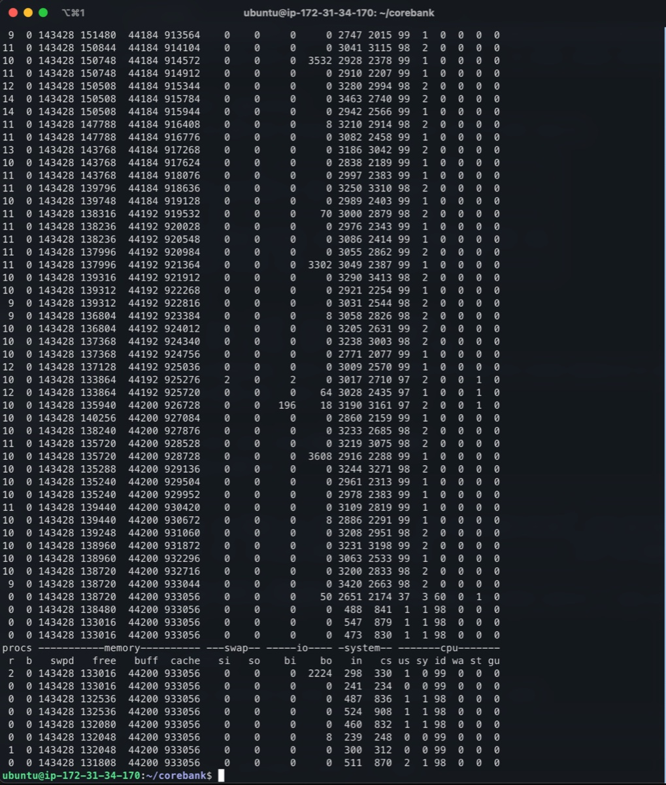

# PH-30 이체 성능·정합성 측정 결과

> 양식과 실행법은 [`harness.md`](harness.md). 이 문서는 **결과만** 쌓는다.
> 재측정할 때마다 절을 추가하고 기존 기록은 지우지 않는다 — 개선폭은 비교로만 보인다.

## 1. 목표

> **서비스 목표는 이체 300 TPS 를 p95 200ms 로 처리하는 것이다**(상향 목표 500 TPS).
> **현 인프라로는 미달**이고, 지금 달성한 선은 **4.94 TPS 에서 p95 0.10초**다.

| 층 | 목표 | 판정 |
|---|---|---|
| **서비스 목표** | **300 TPS 에서 p95 200ms** | 🔴 **현 인프라 미달** |
| 상향 목표 | **500 TPS 에서 p95 200ms** | 🔴 미달 — 판정선은 300 |
| 단계 1 — 풀 20 | **10 TPS 에서 p95 200ms** | ⚠️ **전망 하향** — CPU 가 이미 100%(§3-3) · `#531` 로 검증 |
| 단계 2 — WAS 2대 | **20 TPS 에서 p95 200ms** (선형 가정 **상한**) | ⬜ PH-56 로 검증 |
| **달성** | 단일 EC2 · 풀 10 → **4.94 TPS 에서 p95 0.10초** | ✅ |
| 정합성 | 오차 0 · 짝 100% | ✅ (§4) |

**p95 는 부하 수준과 묶어서만 의미가 있다** — 이 측정에서 1/s 0.07초가 10/s 에서 9.87초로
**141배** 변했다. 「p95 200ms」는 **「N TPS 에서」**를 뺀 채로는 성립하지 않는다.

### 1-1. 이 숫자를 어떻게 정했나

**기획 지표표(`README.md` §지표)의 이체 목표 칸은 「개선」이고 숫자가 없다.** 2차 시작 시점에
기준치가 존재하지 않았기 때문이고, 기준을 만드는 것이 PH-30 의 목적이다(`#385`).

| 값 | 산정 근거 |
|---|---|
| **300 TPS 에서 p95 200ms** (상향 500) | 서비스 관점의 목표치. 리뷰에서 **300~500** 으로 합의했고, 판정이 갈리도록 **300 을 충족선으로** 잡았다 |
| **단계 1 — 10 TPS** | 풀을 20 으로 올리면(`#555`) 2배가 되리라 **봤었다.** CPU 를 재 보니 부하 중 **98~99%** 라(§3-3) **그만큼 안 오를 공산이 크다.** 수치는 `#531` 로 확인한다 |
| **단계 2 — 20 TPS** | PH-56 이 WAS 1대 → 2대를 잰다. **선형 확장을 가정한 상한**이다 |
| **p95 200ms** | 현재 5 TPS 에서 0.10초라 **2배 여유**. REQ-NFR-001 의 조회 단건 500ms 보다 엄격하지만, 이체는 그 안에서 끝나야 체감이 맞다 |

**단계 2 의 20 TPS 는 상한이고, 미달이 정상일 수 있다.** PH-56 의 완료 기준이
*"핫스팟의 2대 확장 증가율이 일반보다 **유의하게 낮다**는 것을 수치로 보인다"* 이다 —
**팀이 「2대 = 2배가 아니다」를 증명하려는 중**이므로, 선형 가정을 결과로 단정하지 않는다.

### 1-2. 300 TPS 로 가는 길 — 다음에 막히는 곳

**「WAS 를 N대로 늘리면 된다」는 틀린 답이다.** 대수를 늘리면 병목이 DB 로 옮겨간다.
**측정한 것과 모르는 것을 구분해 적는다.**

| 순서 | 막히는 곳 | 근거 | 조치 | 소유 |
|---|---|---|---|---|
| 1 | WAS 커넥션 풀 10 | ⚠️ **증상이었다** — 포화는 맞지만(§2-3) **CPU 가 먼저 100%** 다(§3-3) | 20 으로. 다만 **이것만으로는 처리량이 거의 안 는다** | P4 `#555` |
| **2** | WAS 대수 1대 | PH-56 이 1대 → 2대 증가율을 잰다 | ASG 2대 | P5 PH-56 |
| **3** | **RDS `max_connections` 60** | `#555` 계산 — WAS 2대면 20×2+15 = **55**, **3대면 75 > 60** | 파라미터 그룹 신설 + **최초 연결 시 재부팅 1회**(이후 값 조정은 무중단 — AWS RDS 문서: *"When you associate a new DB parameter group with a DB instance, the modified static and dynamic parameters are applied only after the DB instance is rebooted"*). 단 *"메모리 1GB 소형 DB라 숫자만 올리면 메모리가 먼저 부족"*(`#555`)이라 **인스턴스 상향이 선행**일 수 있다 | P4 · P5 |
| 4 | db.t3.small CPU (Multi-AZ 동기 복제) | ❌ **미측정** — WAS CPU 가 먼저 막혀 DB 까지 가지 못했다 | 인스턴스 상향 | P5 |
| **5** | 🔴 **WAS CPU — BCrypt 가 이체 1건에 4회** (login·계좌비번·OTP발급·OTP검증). 행 락·트랜잭션 **안**에서 돈다. 더해 `transaction_sequence` 전역 1행 `FOR UPDATE` · 요청당 커넥션 **9회** | ✅ **측정 완료** — 부하 중 **CPU 98~99% · I/O 대기 0 · 실행 대기 10~11**(vCPU 2개), 부하 끄면 즉시 1%(§3-3) | **BCrypt 를 락 밖으로** · OTP 해시 재검토 · 채번 분산 | P4 `astrokan`(transfer) · P6 `cy389`(otp) · P2 `vsopsw`(account) |
| ~~6~~ | ~~계좌 행 락~~ | ❌ **배제됨** — 계좌를 전부 분산해도 처리량 +2.7%(§3-2) | — | — |

**순서는 5 → 1 이다.** 5번이 먼저 막히고, 1번은 그 결과로 보였던 증상이다 — 풀을 20 으로
늘려도 CPU 가 이미 100% 라 처리량은 거의 안 는다. **BCrypt 를 걷어내기 전에는 2·3·4 가
드러나지도 않는다.** 3번은 확장 쪽에서 중요하다 — **WAS 3대부터는 RDS 설정 변경 없이 못 늘린다.**

---

## 2. 측정 결과 — 2026-10-05 수준별

> **이 절의 「원인」 판단은 §3 에서 정정됐다.** 수치는 그대로 유효하고, 병목을 커넥션 풀로
> 지목한 §2-3·2-4 만 틀렸다. 진짜 원인은 **CPU 포화**다.

| 항목 | 값 |
|---|---|
| 측정 대상 | 운영 ALB → EC2 1대 (t3.small, 2 vCPU) → RDS (MySQL 8.4) |
| 부하 생성 | 별도 리눅스 서버 (4코어 8GB) — 대상과 다른 기기 |
| 데이터 | PH-60 시드 — 고객 1만 · 계좌 3만 · 이체 23.5만 · 원장 50만 |
| 수준 | **1 · 2 · 3 · 5 · 10/s** 고정(`constant-arrival-rate`) · 건당 19,876원 |
| 회차 | 수준마다 **4회 완주** · 1회 3분 → **총 20회** |
| 판정 | 견딤(에러율 <1% · 성공률 100% · p95 <1초) / 열화 / 포화(에러율 >10% 또는 유실) |

### 2-1. 수준별 결과

| 목표 도착률 | 회차 | 이체 접수/s | 이체 성공/s | 도달률 | p95 | p99 | 에러율 | 유실 | 판정 |
|---:|---:|---:|---:|---:|---:|---:|---:|---:|---|
| 1/s | 4 | 0.99 | 0.99 | 100.0% | 0.07s | 0.11s | 0.0% | 0 | ✅ 견딤 |
| 2/s | 4 | 1.98 | 1.98 | 100.0% | 0.07s | 0.17s | 0.0% | 0 | ✅ 견딤 |
| 3/s | 4 | 2.97 | 2.97 | 100.0% | 0.06s | 0.13s | 0.0% | 0 | ✅ 견딤 |
| **5/s** | 4 | **4.94** | **4.94** | **100.0%** | **0.10s** | 0.51s | **0.0%** | 0 | ✅ **견딤** |
| **10/s** | 4 | 4.69 | 2.97 | 50.2% | **9.87s** | 12.09s | **22.0%** | 53 | 🔴 **포화** |

**회차 간 편차가 거의 없다.** 1~5/s 는 네 회차 모두 접수 건수가 **같고**(181·361·541·901건)
성공률 100% 다. 10/s 도 접수 862~896 · 에러율 21.6~22.5% 로 모여 있다.

### 2-2. 어디까지 견뎠나 — **이체 4.94 TPS**

**목표 도착률 5/s 에서 접수 4.94/s · 성공 4.94/s · p95 0.10초 · 에러율 0%.**
901건을 쏴서 **901건 전부 성공**했고 유실도 없다.

| | 1/s → 5/s |
|---|---|
| 처리량 | 0.99 → **4.94/s** (선형) |
| p95 | 0.07 → **0.10초** (거의 안 변함) |

**5/s 까지는 부하를 올려도 지연이 늘지 않는다.** 서버에 여유가 있다는 뜻이다.

### 2-3. 어디서부터 이슈인가 — **5/s 와 10/s 사이**

| 증상 | 5/s | 10/s |
|---|---:|---:|
| **처리량** | 4.94/s | **4.69/s — 오히려 낮아졌다** |
| p95 | 0.10s | **9.87s (98배)** |
| 에러율 | 0.0% | **22.0%** |
| 이체 도달률 | 100% | **50.2%** |
| 유실 | 0 | 53 |

**부하를 2배로 올렸는데 처리량이 떨어진 것이 포화의 결정적 신호다.** 그 지점을 넘으면 추가 요청은
처리량을 늘리는 대신 **기존 요청의 대기 시간을 늘린다.**

**원인을 DB 커넥션 풀 10개로 봤다.** 증거 네 겹이 같은 곳을 가리켰다(부록 A 측정에서 수집).
🔴 **이 판단은 §3-3 에서 뒤집힌다** — 진짜 원인은 **CPU 포화**이고 커넥션 부족은 그 증상이었다.

| 출처 | 값 |
|---|---|
| 설정 | `maximum-pool-size: 10` · `connection-timeout: 3000` (`application-prod.yml`) |
| 측정 | `transfer_duration` med **4회 모두 3.02초** — `connection-timeout` 에 붙어 있다 |
| 서버 로그 | `Connection is not available, request timed out after 3002ms`<br>`(total=10, active=10, idle=0, waiting=23)` — 3시간 범위 **39,594건** |
| 자원 | **CPU 0.38%** · 메모리 27% (521MB / 1.86GB) · `Up 21 hours (healthy)` |

**「CPU 가 0.4% 로 노는데 요청이 실패한다」가 이 결론의 근거였다.** 🔴 **그 0.38% 는 램프업
측정값이고 틀린 전제였다** — iteration 의 89% 가 이체 전에 탈락해 BCrypt 가 거의 돌지 않았다.
수준을 고정해 같은 10/s 를 다시 재니 **CPU 는 98~99%** 였다(§3-3).

med 가 소수점까지 같은 것은 맞다 — `connection-timeout` 이 만든 상수다. 다만 커넥션을 **왜**
그렇게 오래 잡고 있었는지가 빠져 있었고, 그 답이 CPU 였다. 무너진 순서(`/otp/issue` 500 →
OTP 만료 → 계좌비밀번호 검증 500)는 전부 2차 증상이라는 판단은 유효하다.

### 2-4. 어떻게 개선할 것인가

| 순위 | 조치 | 기대 | 소유 |
|---|---|---|---|
| ~~1~~ | ~~`maximum-pool-size` 상향~~ | 🔴 **효과 제한적** — CPU 가 이미 100% 다(§3-3). 막을 이유는 없으나 이것만으로는 안 는다 | P4 (`#555`) |
| 2 | 트랜잭션 구간 축소 — 커넥션 점유 시간 ↓ = 회전율 ↑ | 풀 확대 효과를 배가 | P4 (LOCK-TUNE) |
| 3 | WAS 스케일아웃 (3-Tier) | 분산 | P5 (PH-56) |

**`connection-timeout` 을 늘리는 것은 대책이 아니다.** 커넥션 수가 그대로면 처리량은 변하지 않고
실패를 늦게 알릴 뿐이며, 스레드가 더 오래 묶여 전체가 느려진다.

**풀을 늘리면 다음 병목이 드러난다고 봤고, 실제로 그랬다** — 다만 순서가 반대였다. 풀을 늘리기
전에 **CPU 가 먼저 막혀 있었다**(§3-3). 계좌 행 락은 측정으로 배제됐다(§3-2).

### 2-5. 상용 기준 충족 여부

| 항목 | 판정 | 근거 |
|---|---|---|
| **정합성** | ✅ **충족** | 4항목 전부 0 (§4) |
| **응답시간** | ✅ **충족** — 안정 구간 | 5/s 까지 p95 **0.10초**. REQ-NFR-001 조회 기준(단건 500ms)과 견주면 여유가 크다 |
| **처리량** | 🟡 **규모에 따라 갈린다** | **4.94 TPS 까지 충족**(에러 0%). 그 이상은 미충족 — 10/s 에서 에러율 22% |
| **목표 대비** | 🔴 **서비스 목표(300 TPS) 미달** | 현재 **4.94 TPS 에서 p95 0.10초**. p95 는 목표 200ms 의 **2배 여유**지만 처리량이 60배 부족하다. 가는 길은 §1-2 |

**결론: 「이체 4.94 TPS 에서 p95 0.10초」가 현재 단일 EC2 의 상용 가능 선이다.**
그 이상이 필요하면 **풀 조정이 선행**이고, 조정 후 재측정은 `#531` 이다.
원인은 코드가 아니라 **설정 1곳**이다.

---

## 3. 측정 결과 — 2026-10-06 세션 풀 보정 후

> **계좌 행 락을 완전히 제거했는데 처리량이 2.7% 밖에 안 늘었다. 락은 병목이 아니다.**
> §2 의 「5 TPS 가 한계」는 **교란 변수를 걷어내고도 그대로 섰다.**

### 3-1. 왜 다시 쟀나

§2 의 10/s 구간은 **동시 VU 가 98~105 인데 세션 풀이 20** 이라, 계좌 하나를 5 VU 가 동시에 쳤다.
락 대기 중에도 커넥션은 잡고 있으므로 **「커넥션 부족」인지 「계좌 락」인지 구분할 수 없었다.**

| | 보정 전 | 보정 후 |
|---|---|---|
| 세션(고객) 수 | 20 | `MAX_VUS` 와 같게 (**200**) |
| 받는 쪽 | 옆 VU 의 출금 계좌 | 출금 집합 **밖** |
| 10/s 계좌당 동시 VU | **5** | **1** |

수준 **5 · 10/s** 를 4회씩. **5/s 는 대조군**(보정 전에도 VU 6~23 이라 겹침이 없던 구간).
그 외 조건은 §2 와 같다 — 같은 ALB·EC2·RDS, 풀 10, `#555` 머지 전.

### 3-2. 결과 — 4회 중앙값, 건수는 3분 측정 구간 기준

| 수준 | 세트 | 접수(건) | 성공(건) | 성공/s | p95 | 에러율 | 유실 |
|---|---|---:|---:|---:|---:|---:|---:|
| 5/s | ① 보정 전 | 901 | 901 | 5.01 | 0.10s | 0.0% | 0 |
| 5/s | **② 보정 후** | 900 | 900 | 5.00 | 0.09s | 0.0% | 0 |
| 10/s | ① 보정 전 | 878 | **557** | 3.09 | 9.87s | 22.0% | 53 |
| 10/s | **② 보정 후** | 1024 | **572** | **3.17** | **9.85s** | 21.0% | 48 |

| | |
|---|---|
| ✅ 대조군 5/s | 901 → 900건, p95 0.10 → 0.09초. **동일 — 보정이 다른 걸 안 건드렸다** |
| 🔴 10/s | 성공 **+2.7%** · p95 **변화 없음** |
| ⚠️ 접수만 +17% | **더 받아서 더 실패했다.** 처리 능력은 그대로다 |

> **처리량은 건수로 비교한다.** `iterations.rate` 는 `setup()` 을 포함한 전체 실행 기준이라,
> 세션 200개를 만드는 보정 후에는 같은 901건이 **4.94/s 에서 4.50/s 로** 보인다.

### 3-3. 그럼 어디가 병목인가 — **이체 트랜잭션 안**

| 구간 | 5/s | 10/s | 배수 |
|---|---:|---:|---:|
| **`/transfers` 호출** | **39ms** | **5,194ms** | **133배** |
| 앞 3요청 1건당 | 100ms | 1,040ms | 10배 |

커넥션 풀 고갈 **단독**이라면 모든 요청이 고르게 느려져야 하는데 **이체가 13배 더 심하다.**
5/s 에서는 이체가 앞 요청보다 오히려 빠르다(39ms 대 100ms). 코드로 확정된 점유 구조는 셋이다.

| | 구조 | 근거 |
|---|---|---|
| ① | **BCrypt(강도 10) 가 행 락·커넥션 안에서 돈다** — `/accounts/{id}/password/verify`, `/otp/verify`. 후자는 같은 트랜잭션에서 **Redis 쓰기까지** 대기 | `AccountPasswordVerificationProcessor.java:24,34` · `OtpVerificationProcessor.java:33,53,64` |
| ② | **전역 직렬화 행** — 모든 웹 이체가 `transaction_sequence(오늘, 'WB')` 1행을 `FOR UPDATE`. 채널이 하드코딩이라 **계좌를 분산해도 이 행은 안 분산된다** | `TransactionSequenceJpaRepository.java:139-147` · `TransferRequest.java:21` |
| ③ | **요청 1건이 커넥션을 9번 빌린다** — 초당 40요청이면 **초당 360회 체크아웃**, 풀은 10개 | `TransferExecutionService.java:105-106, 126-127, 298` |

**CPU 를 재서 확정했다.** 10/s 를 다시 돌리며 EC2 에서 `vmstat 2` 를 띄웠다.

| 시점 | `us` 사용자 CPU | `id` 유휴 | `wa` I/O 대기 | `r` 실행 대기 |
|---|---:|---:|---:|---:|
| 부하 전 | 0~2% | 98~100 | 0 | 0 |
| setup — **로그인만** 200회 | 42~52% | 47~56 | 0 | 1 |
| **본 측정 3분** | **98~99%** | **0** | **0** | **10~11** |
| k6 종료 직후 | 37% → **1%** | → **98** | 0 | **0** |

**부하를 켜면 99%, 끄면 즉시 1% 로 돌아온다.** 그리고 **`wa` 가 내내 0** 이다 — DB 를 기다린 게
아니라 **CPU 를 태웠다.** `r` 이 10~11 인데 vCPU 는 2개라 실행 대기가 5배 쌓였다.

원본 출력이다. 마지막 네 줄이 **부하가 끝나는 순간**으로, `99 1 0` 에서 `37 3 60` 을 거쳐
`1 1 98` 로 떨어진다.

```
 r  b   swpd   free   buff  cache   si   so    bi    bo   in   cs us sy id wa st gu
10  0 143428 135240  44200 929952    0    0     0     0 2978 2383 99  1  0  0  0  0
11  0 143428 139440  44200 930420    0    0     0     0 3109 2819 99  1  0  0  0  0
10  0 143428 139248  44200 931060    0    0     0     0 3208 2951 98  2  0  0  0  0
10  0 143428 138960  44200 932296    0    0     0     0 3063 2533 99  1  0  0  0  0
 9  0 143428 138720  44200 933044    0    0     0     0 3420 2663 98  2  0  0  0  0
 0  0 143428 138720  44200 933056    0    0     0    50 2651 2174 37  3 60  0  1  0
 0  0 143428 138480  44200 933056    0    0     0     0  488  841  1  1 98  0  0  0
 0  0 143428 133016  44200 933056    0    0     0     0  547  879  1  1 98  0  0  0
```


이 회차의 k6 결과는 §3-2 의 10/s 와 같다(iteration 1,751 · 에러율 20.7% · 유실 49).

**산술도 맞는다.** 2 vCPU 는 초당 2,000ms 의 CPU 시간이고, 10/s × BCrypt 4회 = 초당 40회다.
2,000 ÷ 40 = **50ms/회** — BCrypt 강도 10(`SecurityConfig.java:36`)의 전형값이다.
setup 구간이 같은 방향을 가리킨다: **로그인만** 200회 하는데 CPU 가 45% 올랐고, 로그인은 BCrypt 1회다.

> **CPU 포화는 확정이고, BCrypt 가 지배적이라는 건 유력하지만 단정은 아니다.** 위 역산은
> 「CPU 를 BCrypt 가 전부 썼다」는 가정이고, 정확한 분해는 프로파일링이 필요하다.

**따라서 커넥션 부족은 증상이다.** CPU 대기로 각 요청이 느려져 커넥션을 오래 잡은 것이고,
**풀을 20 으로 늘려도 CPU 가 이미 100% 라 처리량은 거의 안 늘어난다**(`#555`).

### 3-4. 이 결과가 바꾸는 것

| | |
|---|---|
| §2 의 결론과 10/s 측정 | ✅ **유지 — 더 단단해졌다.** 교란 변수를 빼고도 같은 값 |
| `#555` 풀 10 → 20 | ⚠️ **효과가 거의 없을 것이다** — CPU 가 이미 100% 다. 막을 이유는 없지만 이것만으로 10 TPS 는 안 된다 |
| 다음에 고칠 것 | **BCrypt 를 행 락·트랜잭션 밖으로**, 그리고 **OTP 코드 해시 재검토** — 6자리·3분 만료에 강도 10 은 과하다 |

---

## 4. 정합성 판정 — **합격**

`integrity.js` 로 **동일 계좌 1개에 동시 100건**(토큰 선발급)을 넣고 `verify_integrity.sql` 로 대조했다.

| 항목 | 값 | 기준 | 판정 |
|---|---|---|---|
| 잔액 오차 | **0원** (99,960,617 → 97,973,017, 차이 1,987,600 = 19,876 × 100) | 0 | ✅ |
| 원장 짝 무결성 | **0건 어긋남** (`broken_ledger_pairs=0`) | 100% | ✅ |
| 한도 적립 합 일치 | **0건 어긋남** (`limit_usage_mismatches=0`) | 일치 | ✅ |
| 잔액-원장 대조 | **0건 어긋남** (`balance_mismatches=0`) | 0 | ✅ |
| 데드락 | 발생 없음 | 기록 | — (판정 항목 아님) |

판정 SQL 은 운영 RDS 에서 **2026-10-01 00:00 ~ 10-02 00:00 전일 범위**로 실행했다
(총 이체 1,671건 / 성공 1,500건 / 실패 171건 / 36,578,063원).

> **판정 쿼리를 한 번 고쳤다.** 원장 짝 쿼리가 `INNER JOIN` 이라 **「성공인데 원장이 0행」인
> 이체를 조인 단계에서 잃어버렸다**(PR #530 리뷰). 한도 쿼리도 적립 행이 없는 고객을 놓쳤다.
> MySQL 8.4 에 결함을 재현해(기존 1건 → 보정 3건) `c7778f00` 로 고친 뒤 **같은 데이터로
> 재실행**해 위 결과를 얻었다(10/4).

**성능 한계와 정합성은 분리돼 있다.** 요청의 일부가 커넥션을 못 받아 실패하는 부하에서도,
성공한 건의 원장·잔액·한도는 1원도 틀리지 않았다.

### 4-1. 재확인 — 2026-10-06 (보정 후)

세션 풀 보정 후에도 같은 판정을 돌렸다. `integrity.js` 동일 계좌 100건은 **100건 전부 성공**
(`transfer_success` 100%, 요청 실패 0/401, p95 1.82초)했고, 판정 SQL 은 **당일 전체**로 실행했다.

| 항목 | 결과 |
|---|---|
| 원장 짝 · 잔액 오차 · 한도 적립 | **3항목 전부 0** |
| 당일 이체 | 14,122건 — 성공 13,169건(269,011,227원) · **실패 953건** |

**실패가 953건 나는 동안에도 장부는 1원도 틀리지 않았다.** 실패 건이 잔액을 건드리지 않고
롤백됐다는 뜻이다. 당일 전체에는 다른 트랙의 작업도 섞여 있어 판정 범위가 측정분보다 넓다.

**핫스팟은 분산보다 20배 느리다** — 동일 계좌 100건의 p95 가 1.82초인데 분산 5/s 는 0.09초다(§3-2).
계좌 행 락은 **핫스팟에서만** 비용이 된다. 분산 부하에서 병목이 아니라는 §3 의 결과와 모순되지 않는다.

---

## 5. 다른 트랙에 미치는 영향

**P4 LOCK-TUNE(S3)은 현재 상태로 측정이 불가능하다.** 10/s 에서 요청의 절반이 이체 로직에
도달하기 전에 커넥션을 못 받고 떨어지므로(도달률 50.2%), 락을 개선해도 수치가 움직이지 않는다.
**풀을 먼저 조정해야** 락 튜닝의 효과를 잴 수 있다.

풀 크기는 RDS `max_connections` 안에서 WAS 대수를 곱해 잡아야 해 **P5 와도 조율이 필요**하다.

| 후속 | 내용 |
|---|---|
| [#531](https://github.com/corebank-tech/corebank-server/issues/531) | 풀 조정 후 재측정 — 세션 풀 보정(리뷰 지적)도 함께 |
| [#532](https://github.com/corebank-tech/corebank-server/issues/532) | 한도 경로 `checkAndReserve` p95·p99 분리 측정 — 선행은 `#531` |

---

## 6. 재측정 방법

**같은 수준·같은 회차로 다시 돌려 비교한다.**

수준마다 `RATE` 를 고정해 4회씩 돌린다(`harness.md` §6).

```bash
k6 run -e BASE_URL=https://<측정 대상>/api/v1 -e RATE=<수준> -e DURATION=3m \
  --summary-trend-stats="avg,min,med,p(90),p(95),p(99),max" \
  --summary-export="level<수준>_run<회차>.json" perf/k6/load.js
```

> **아래 표는 10/05 진단 기록이고, S4 와 비교할 개선 전 기준선이 아니다.** 기준선은 [§8](#8-기준선-교체--2026-10-1620-redis-모드-제거-판정-ph-101-②)에 따라
> PH-49c 적용 후 재측정으로 정하고, 그 전까지는 [§8-2](#8-2-수준별-중앙값--4회-중앙값) JDBC 행(B')을 참고한다.
> 특히 10/s p95 는 Redis 모드 시절 값(9.87s)과 비교하지 않는다 — B' 는 6,058.8ms 다.

| 비교 대상 | 개선 전 (2026-10-05) |
|---|---:|
| **최대 안정 처리량** | **4.94/s** (5/s 수준, 에러 0%) |
| 그 지점 p95 | 0.10s |
| **변곡점** | **10/s 에서 포화** |
| 10/s 접수 처리량 | 4.69/s (5/s 보다 낮다) |
| 10/s p95 · 에러율 | 9.87s · 22.0% |
| 10/s 이체 도달률 | 50.2% |

**풀을 늘리면 최대 안정 처리량이 올라가고 변곡점이 오른쪽으로 밀린다.** 그 두 값이 개선폭이다.
수준은 `1·2·3·5·10` 을 그대로 쓰되, 10/s 가 견딤으로 바뀌면 **20·40/s 를 추가**해 새 변곡점을 찾는다.

---

## 7. PH-24 훅 B 전후 — 2026-10-19~20 로컬

> **훅을 켜면 견딤 구간(5~13/s)에서 이체 지연 중앙값이 건당 2.6~15.6ms 늘고, 처리량과 최대 안정 처리량은 그대로다.**
> 포화 구간(15/s)은 회차 간 편차가 ON/OFF 차이보다 커서 판정하지 못했다.

훅은 릴리스 1에 함께 나가 운영에서는 전후를 잴 수 없다. 그래서 [tasks.md PH-24](tasks.md#ph-24-gl-분개-서비스--이체-기표-훅--glapi)대로 P3가 로컬에서 쟀다.

### 7-1. 목표

허용 저하율 수치 목표는 없다. PH-24 완료 기준(전표 1건, 차대변 일치, 훅 예외 시 롤백)에 성능 조건이 없기 때문이다.
이 측정은 **같은 수준에서 최대 안정 처리량이 줄지 않는지**와 **수준별 건당 추가 지연**만 판정한다.

### 7-2. 측정 조건

```
대상 코드: dev 764101e9 bootJar 1개
  ON  = 그대로
  OFF = 같은 jar에서 GlLedgerPostingHook.class만 뺌 (LedgerPostingHook 구현체 0개 — 이체 경로는 훅 커밋 adae0637 이전과 같다.
        채번 풀 빈 GlVoucherSequenceAdapter와 JournalPostingService는 남아 쓰이지 않는 커넥션 3개가 열려 있다)
  dev 764101e9는 릴리스 1 이후 머지분(#516 거래일 대입 등)을 포함한다. ON과 OFF에 똑같이 들어 있다
측정 대상: MacBook(Apple Silicon) JVM -Xms1g -Xmx1g, local 프로필 + 아래 명령의 덮어쓰기
  (SQL 로그 끔, 메인 풀 Hikari 10 · connection-timeout 3s · max-lifetime 570s — 운영과 같음. local 기본값은 timeout 30s)
  채번 풀 gl-voucher-sequence 3개는 메인 풀 설정을 복사한다(ON과 OFF 모두)
  local 프로필이라 스케줄러가 켜져 있다. 로그로 확인된 겹침은 13/s OFF 1회차의 16:15 인증 토큰 정리(42,676행 삭제) 1건이고,
  로그를 남기지 않는 정리 작업(매시 정각 등)은 겹쳤는지 확인하지 못했다
DB: Docker MySQL 8.4.10, 버퍼 풀 128MB · binlog 켬 · sync_binlog=1 (운영 RDS db.t4g.micro와 같은 값)
부하 생성: 같은 Mac의 k6 1.7.1 (harness.md §7 권장과 다름, ON/OFF에 같은 조건)
데이터 규모: PH-60 + PH-60b 누적 로컬 적재, 적재 직후 실측 — 고객 60,000 · 계좌 180,000 · 이체 3,135,000
          · 원장 6,500,000 · 전표 3,235,001 · 분개 6,470,002
수준: 5 · 10 · 13 · 15 /s 고정 (사전 탐색: ON 10/s 견딤, 15/s 열화)
회차: 수준마다 6회, 실행 순서 OFF1 → ON1 → ON2 → OFF2 → OFF3 → ON3 · 1회 3분
      · 회차마다 앱을 새로 띄우고 같은 수준 30초 워밍업을 버림
판정: 수준 판정(견딤·열화·포화)은 §3과 같이 회차 중앙값 지표로 한다. 회차별 판정은 표에 함께 둔다
```

커밋 adae0637 앞뒤를 따로 빌드하지 않은 이유: 그 뒤에 들어온 채번 풀 수정(61da2b5f)이 빠져 머지된 훅 최종 코드의 비용이 아니게 된다.

재현 명령이다. DB는 PH-60(`ph60_minimum_seed.md`)과 PH-60b(`ph60b_bulk_seed.md` §9)를 적재한 MySQL을 3307로 띄운 상태다.
두 시드 모두 `--spring.profiles.active=local,phase2-seed`에 각 문서의 실행 플래그(`--app.phase2-seed.minimum.execute=true`, `--app.phase2-seed.bulk.execute=true`)를 붙여 차례로 돌렸다.
`ph60_minimum_seed.md` §1-1의 `phase2-seed` 단독 명령은 `AccountStatusPort` 빈이 없어 지금 기동에 실패한다.

```bash
./gradlew bootJar -x test
cp build/libs/corebank-0.0.1-SNAPSHOT.jar hook-on.jar
cp build/libs/corebank-0.0.1-SNAPSHOT.jar hook-off.jar
zip -d hook-off.jar 'BOOT-INF/classes/com/shinhan/corebank/gl/adapter/in/transfer/GlLedgerPostingHook*.class'

# 회차마다 VARIANT=on|off 로 띄우고, 워밍업(DURATION=30s) 한 번 뒤 harness.md §6 명령(DURATION=3m)을 BASE_URL=http://localhost:18080/api/v1 로 돌린다
java -Xms1g -Xmx1g -jar hook-${VARIANT}.jar \
  --spring.profiles.active=local --server.port=18080 \
  --spring.datasource.url='jdbc:mysql://localhost:3307/minicore?useSSL=false&allowPublicKeyRetrieval=true&connectionTimeZone=Asia/Seoul&forceConnectionTimeZoneToSession=true&characterEncoding=UTF-8&rewriteBatchedStatements=true' \
  --spring.datasource.username=root --spring.datasource.password=localpw \
  --spring.datasource.hikari.connection-timeout=3000 --spring.datasource.hikari.max-lifetime=570000 \
  --spring.jpa.show-sql=false --logging.level.org.hibernate.SQL=info
```

### 7-3. 수준별 결과

| 수준 | 훅 | 회차 | 이체 접수/s | 이체 성공/s | 도달률 | med | p95 | p99 | 에러율 | 유실 | 판정 |
|---:|---|---:|---:|---:|---:|---:|---:|---:|---:|---:|---|
| 5/s | OFF | 1 | 5.01 | 5.01 | 100.0% | 45ms | 123ms | 317ms | 0.00% | 0 | 견딤 |
| 5/s | OFF | 2 | 5.00 | 4.98 | 100.0% | 257ms | 3324ms | 5566ms | 0.11% | 1 | 포화 |
| 5/s | OFF | 3 | 5.01 | 5.01 | 100.0% | 41ms | 83ms | 260ms | 0.00% | 0 | 견딤 |
| 5/s | ON | 1 | 5.01 | 5.01 | 100.0% | 48ms | 135ms | 415ms | 0.00% | 0 | 견딤 |
| 5/s | ON | 2 | 5.01 | 5.01 | 100.0% | 52ms | 197ms | 418ms | 0.00% | 0 | 견딤 |
| 5/s | ON | 3 | 5.01 | 5.01 | 100.0% | 43ms | 67ms | 118ms | 0.00% | 0 | 견딤 |
| 10/s | OFF | 1 | 10.01 | 10.01 | 100.0% | 58ms | 129ms | 396ms | 0.00% | 0 | 견딤 |
| 10/s | OFF | 2 | 10.01 | 10.01 | 100.0% | 54ms | 92ms | 304ms | 0.00% | 0 | 견딤 |
| 10/s | OFF | 3 | 10.01 | 10.01 | 100.0% | 55ms | 97ms | 361ms | 0.00% | 0 | 견딤 |
| 10/s | ON | 1 | 10.00 | 10.00 | 100.0% | 66ms | 123ms | 427ms | 0.00% | 0 | 견딤 |
| 10/s | ON | 2 | 10.01 | 10.01 | 100.0% | 63ms | 107ms | 399ms | 0.00% | 0 | 견딤 |
| 10/s | ON | 3 | 10.01 | 10.01 | 100.0% | 63ms | 105ms | 396ms | 0.00% | 0 | 견딤 |
| 13/s | OFF | 1 | 12.92 | 12.92 | 100.0% | 85ms | 2315ms | 3342ms | 0.00% | 14 | 포화 |
| 13/s | OFF | 2 | 13.01 | 13.01 | 100.0% | 63ms | 315ms | 671ms | 0.00% | 0 | 견딤 |
| 13/s | OFF | 3 | 13.01 | 13.01 | 100.0% | 53ms | 131ms | 368ms | 0.00% | 0 | 견딤 |
| 13/s | ON | 1 | 12.90 | 12.90 | 100.0% | 940ms | 2963ms | 3866ms | 0.00% | 19 | 포화 |
| 13/s | ON | 2 | 13.01 | 13.01 | 100.0% | 79ms | 218ms | 497ms | 0.00% | 0 | 견딤 |
| 13/s | ON | 3 | 13.01 | 13.01 | 100.0% | 60ms | 192ms | 480ms | 0.00% | 0 | 견딤 |
| 15/s | OFF | 1 | 14.18 | 14.03 | 98.5% | 1520ms | 7574ms | 10204ms | 0.64% | 108 | 포화 |
| 15/s | OFF | 2 | 13.18 | 11.99 | 92.6% | 4377ms | 10802ms | 14439ms | 4.04% | 138 | 포화 |
| 15/s | OFF | 3 | 11.98 | 11.03 | 84.0% | 4936ms | 10504ms | 13591ms | 6.17% | 133 | 포화 |
| 15/s | ON | 1 | 11.53 | 10.02 | 80.6% | 5247ms | 11316ms | 14435ms | 8.32% | 126 | 포화 |
| 15/s | ON | 2 | 9.41 | 5.34 | 66.8% | 8033ms | 14451ms | 17149ms | 18.57% | 164 | 포화 |
| 15/s | ON | 3 | 14.79 | 14.79 | 100.0% | 1090ms | 3564ms | 4720ms | 0.00% | 38 | 포화 |

| 수준 | OFF med | ON med | 차이 | OFF 성공/s | ON 성공/s |
|---:|---:|---:|---:|---:|---:|
| 5/s | 45.1ms | 47.8ms | **+2.6ms** (+5.9%) | 5.01 | 5.01 |
| 10/s | 55.4ms | 63.4ms | **+8.0ms** (+14.4%) | 10.01 | 10.01 |
| 13/s | 62.9ms | 78.5ms | **+15.6ms** (+24.8%) | 13.01 | 13.01 |
| 15/s | 4,377ms | 5,247ms | 판정 불가 | 11.99 | 10.02 |

회차 중앙값이다. 튀는 회차(5/s OFF 2회차, 13/s 1회차의 OFF와 ON)가 있어 평균을 쓰지 않았다. 차이와 퍼센트는 반올림 전 값으로 계산했다.

| 정합성 (전 회차 종료 후) | 결과 |
|---|---|
| ON 회차 성공 이체 수 = 전표 수 | 일치 (15/s ON 6,236 = 6,236) |
| OFF 회차 전표 | 0 |
| 차대변 불일치 전표 | 0 |
| `verify_integrity.sql` 원장 짝 · 잔액 오차 · 한도 적립 합 ≠ 실제 이체액 | 0 · 0 · 0 (10/19~20 전체, 이체 53,365건 중 성공 52,562건) |

53,365건은 표의 24회와 워밍업 말고도 사전 탐색(스모크, 램프업, 10~25/s 탐색)을 포함한다. 이체 행이 생기기 전에 커넥션을 못 받아 실패한 요청은 행이 없어 이 건수에 들어가지 않는다.

한도 적립은 하루 누계(`transfer_limit_daily_usage`)와 비교하므로 ON과 OFF 회차를 나눠 볼 수 없다. 두 날 모두 ON과 OFF가 섞인 하루 전체로 검사했다.

15/s 포화의 근거다. 앱 로그 건수는 워밍업 30초를 포함하고, HTTP 실패와 유실은 측정 3분 기준이다.

| 15/s 회차 | 메인 풀 대기 초과 | 처리되지 않은 예외 | HTTP 실패 | 유실 |
|---|---:|---:|---:|---:|
| OFF 1 · 2 · 3 | 124 · 869 · 1,399 | 55 · 397 · 662 | 67 · 405 · 583 | 108 · 138 · 133 |
| ON 1 · 2 · 3 | 1,773 · 3,620 · 20 | 804 · 1,674 · 9 | 772 · 1,574 · 0 | 126 · 164 · 38 |

풀 대기 초과는 전 회차 모두 메인 풀(`HikariPool-1`)에서 났고 채번 풀(`gl-voucher-sequence`)은 0건이다. HTTP 실패가 난 회차는 같은 규모의 풀 대기 초과와 처리되지 않은 예외를 함께 남겼다. 유실은 풀 대기 초과 없이도 난다 — 15/s ON 3회차(풀 대기 초과 20, HTTP 실패 0, 유실 38)와 13/s OFF 1회차(풀 대기 초과 0, 유실 14)는 지연이 늘어 k6 VU 200개가 모두 묶인 경우다.

### 7-4. 결론

| 항목 | 내용 |
|---|---|
| **어디까지 견뎠나** | ON과 OFF 모두 **13/s**(회차 중앙값 p95 OFF 315ms · ON 218ms, 유실 0). 회차별로는 둘 다 1회차가 포화였다. 최대 안정 처리량 변화 없음 |
| **어디서부터 이슈인가** | ON과 OFF 모두 15/s에서 3회 전부 포화. 에러는 Hikari 풀 대기 초과에서, 유실은 지연 증가에서 온다(위 근거 표) |
| **저하율** | 견딤 구간 지연 중앙값 +2.6~15.6ms(+5.9~24.8%). p95·p99는 같은 변형끼리의 회차 편차보다 차이가 작아 판정 불가 |
| **포화 구간** | 15/s 성공/s 중앙값 OFF 11.99 → ON 10.02(−16%)이지만 ON 범위가 5.34~14.79로 OFF 범위(11.03~14.03)를 덮는다. 3쌍 중 2쌍에서 ON이 낮았다 |
| **어떻게 개선할 것인가** | 해당 없음. 이 측정은 훅의 비용을 재는 것이고 훅 자체는 개선 대상이 아니다. 15/s 포화는 OFF에서도 나므로 훅 몫이 아니다. 로컬에서는 CPU를 재지 않아 포화의 근본 원인은 진단하지 않았다(운영 진단은 §3-3) |
| **상용 기준** | 훅은 견딤 구간의 처리량을 깎지 않아 **충족**. 로컬 절대값은 운영과 달라 옮길 수 있는 것은 상대 비교뿐이다. 추가 지연은 부하가 오를수록 커져(5/s 2.6ms → 13/s 15.6ms) 고정 상수로 옮길 수 없다 |

---

## 8. 기준선 교체 — 2026-10-16~20 Redis 모드 제거 판정 (PH-101-②)

> **Redis 를 빼도 성능 손해가 없다. 5/s 까지는 두 모드가 같고, 10/s 포화 구간에서는 JDBC 가 낫다.**
> **§8-2 의 JDBC 행(B')은 PH-49c 적용 전 PH-30 참고 기준선이다.** S4 비교 기준은 PH-49c 적용 후 재측정으로 정한다([ADR-0007](../adr/0007-remove-redis.md#측정과-판정)).
> 5/s 는 §3 과 같은 수준이지만 10/s 는 크게 다르다(§8-3).

측정 조건 · 근거 · 회차별 원자료는 [ph101_redis_removal_results.md](ph101_redis_removal_results.md) 에 있다.
8회차(Redis · JDBC 각 4회) × 5수준(1 · 2 · 3 · 5 · 10/s) × 3분 고정 도착률로 쟀다.

### 8-1. 판정 — **Redis 제거 가능**

| 기준 | 결과 | |
|---|---|:---:|
| 1~5/s 성공률 · 에러율 (±0.5%p) | 회차별 두 모드 최대 차 **0.11%p**(4회차 1/s 에러율). **1회차 5/s 제외** — 포함하면 성공률 차 0.89%p 로 기준을 넘는다 | ✅ |
| 포화가 시작되는 도착률 — **대체: 10/s 판정 등급 일치** | 두 모드 모두 5/s 견딤 · 10/s **포화**. 5/s 와 10/s 사이를 재지 않아 시작점 자체는 미측정 | ✅ |
| 엔드포인트별 p95 | 5/s 네 단계 **범위 전부 겹침** | ✅ |
| RDS CPU · 연결 (1~5/s) | 5/s 여덟 회차 **11.8~15.0% · 13~14** (기준 70% · 48) | ✅ |
| 정합성 | 여덟 회차 **0/0/0**, 핫스팟 100/100 실패 0 | ✅ |
| **절대 하한 5/s — p95** | 1회차 제외 일곱 회차 **84.2~129.5ms** (기준 1초) | ✅ |
| **절대 하한 5/s — 커넥션 timeout** | 2~8회차 **0건** | ✅ |

1회차는 릴리스 1 배포·마이그레이션 직후라 DB 캐시가 콜드였다. 5/s 판정에서만 분리했고(측정 전 기준에 없던 처리로, 결과를 본 뒤 정했다),
근거는 [ph101_redis_removal_results.md §3](ph101_redis_removal_results.md#3-1회차를-5s-판정에서-분리한-근거) 에 있다.

### 8-2. 수준별 중앙값 — 4회 중앙값

| 모드 | 수준 | 성공률 | 에러율 | 유실 | 이체 p95 | 도달률 | 판정 |
|---|---:|---:|---:|---:|---:|---:|---|
| Redis | 1/s | 100% | 0% | 0 | 134.4ms | 100.6% | 견딤 |
| Redis | 2/s | 100% | 0% | 0 | 103.5ms | 100.2% | 견딤 |
| Redis | 3/s | 100% | 0% | 0 | 85.7ms | 100.2% | 견딤 |
| Redis | 5/s | 100% | 0% | 0 | 113.8ms (**98.1ms**) | 100.1% | **견딤** |
| Redis | 10/s | 53.72% | 23.51% | 45 | 9,792.6ms | 51.1% | **포화** |
| JDBC | 1/s | 100% | 0% | 0 | 144.9ms | 100.6% | 견딤 |
| JDBC | 2/s | 100% | 0% | 0 | 103.8ms | 100.2% | 견딤 |
| JDBC | 3/s | 100% | 0% | 0 | 85.3ms | 100.2% | 견딤 |
| JDBC | 5/s | 100% | 0% | 0 | **94.8ms** | 100.1% | **견딤** |
| JDBC | 10/s | 75.35% | 19.99% | 23 | 6,058.8ms | 50.6% | **포화** |

Redis 5/s 의 괄호는 1회차를 뺀 값이다.
**견딘 최고 수준은 두 모드 모두 5/s** — 측정한 수준 중 「견딤」의 최고값이다. 처리량(건/s)은 따로 집계하지 않았다.

### 8-3. 개선 전 기준선 — §2 · §3 · §6 의 10/s 값과 비교하지 않는다

| | §3-2 ② (2026-10-06 보정 후) | 이번 JDBC (B') |
|---|---:|---:|
| 5/s 이체 p95 | 0.09초 | 94.8ms |
| 견딘 최고 수준 | 5/s | 5/s |
| 10/s 이체 p95 | 9.85초 | **6,058.8ms** |

**5/s 는 §3 과 같은 수준이다.** PH-60b 적재(10/10)와 릴리스 1(10/16) 뒤에도 5/s 이체 p95 는
0.1초 안쪽이다. §3 의 0.09초는 두 자리로 반올림한 값이라 94.8ms 와의 차이는 반올림 범위 안이다.

**10/s 는 다르다.** §2 · §3 · §6 의 9.8초대는 Redis 모드 시절 값이고, 이번 Redis 모드 중앙값(9,792.6ms)도
그와 같다. 10/s 의 −38% 는 모드 전환 몫이라, **S4 를 §2 · §3 · §6 과 비교하면 개선 효과가 부풀려진다.**

**S4 비교 기준은 아직 확정이 아니다.** B' 는 PH-49c(JDBC 세션) 적용 전 수치다. PH-49c 가 10/23 릴리스 2 에
들어가면 P6 이 10/26 전에 `provider=jdbc` 로 다시 재고, 비교 조건이 맞으면 그 값을 새 개선 전 기준선으로
제안한다([ADR-0007](../adr/0007-remove-redis.md#측정과-판정)). 그 전까지는 §8-2 JDBC 행을 참고한다.

10/s 에서 두 모드가 갈리는 것은 **`transfer` 한 단계뿐이고 앞 세 단계는 같다**
([ph101_redis_removal_results.md §2](ph101_redis_removal_results.md#2-10s--차이는-transfer-한-단계에만-있다)).
§3-3 기준으로 `transfer` 구간에 걸린 것은 ② 채번 행 `FOR UPDATE`(LOCK-TUNE)와 ③ 커넥션 9회
체크아웃(#555)이다. BCrypt(#568 · #569)는 앞 단계(`account_password` · `otp_verify`)에서 돈다.

## 부록 A. 2026-10-01 램프업 측정 (범위 탐색)

수준별 측정 전에 **한계가 어디쯤인지 좁히려고** 3분간 초당 이체 시도 5 → 60건으로 올리며 4회 돌렸다.
세션 풀 20, 그 외 조건은 §2 와 같다.

| 지표 | 값 |
|---|---:|
| 이체 접수 (전 구간 평균) | 2.50/s |
| 이체 p95 · p99 | 11.82s · 14.82s(1회 값) |
| 에러율 | 51.4% |
| 설정 도착률 달성률 | 78.7% (`dropped` 중앙값 1,175 / 계획 5,512) |

> ⚠️ **이 수치를 한계로 읽으면 안 된다.** 램프업은 5 → 60/s 로 올라가므로 후반 구간에서 대량
> 실패가 나고, k6 종료 요약이 **정상 구간과 포화 구간을 한 평균으로 섞는다.** 실제로 §2 에서
> 5/s 를 에러율 0% 로 처리하는 것이 확인됐다 — **2.50/s 는 한계가 아니라 과소평가다.**
> 한계점을 말하려면 수준을 고정해 따로 재야 한다(`harness.md` §3-1).

이 측정에서 얻은 것은 둘이다 — **병목이 DB 커넥션 풀이라는 증거 네 겹**(§2-3 에 옮겨 적었다)과
**수준별 측정 범위를 1~10/s 로 잡은 근거**.
