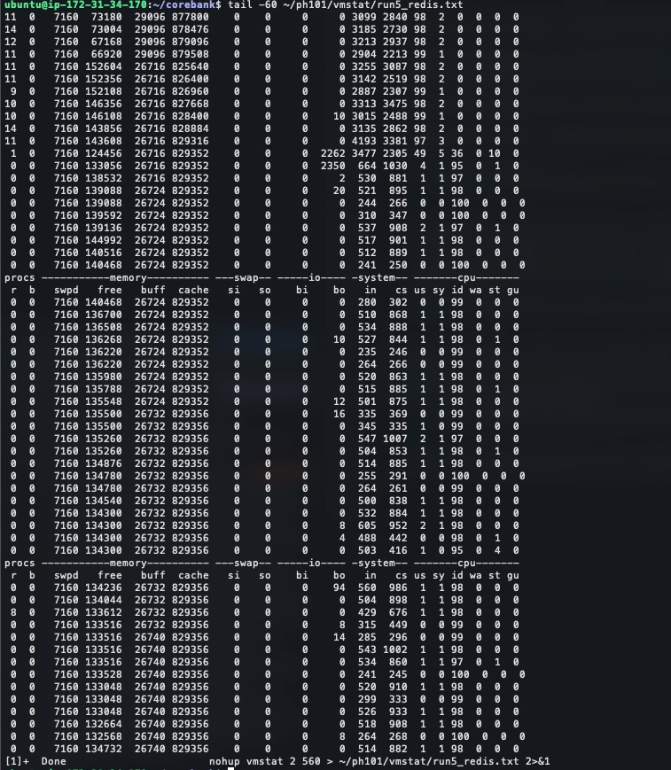
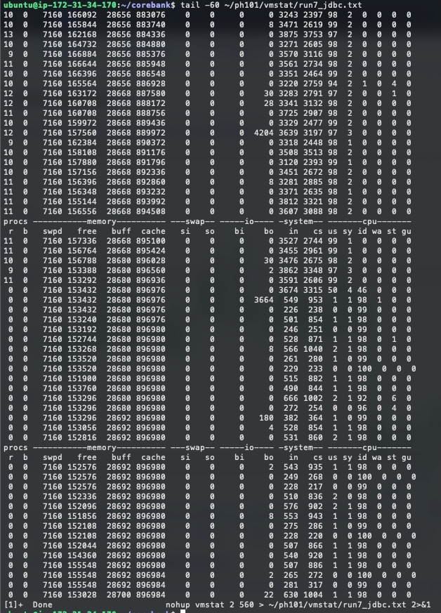

# PH-101-② Redis 제거 판정 측정 결과

> `app.ephemeral-store.provider` 를 `redis` / `jdbc` 로 번갈아 돌려 판정한 근거다.
> 판정 요약은 [harness_results.md §8](harness_results.md#8-기준선-교체--2026-10-1620-redis-모드-제거-판정-ph-101-②).
> 재측정 시 기존 결과를 지우지 않고 추가한다.

## 1. 측정 조건

| | |
|---|---|
| 측정 | 2026-10-16 ~ 10-20 |
| 회차 | **8회** — R · J · J · R · R · J · J · R (전환 4회, 누적 행 증가를 두 모드에 대칭으로) |
| 수준 | 1 · 2 · 3 · 5 · 10/s **고정 도착률**, 각 3분 |
| 스크립트 | [`perf/k6/load.js`](../../perf/k6/load.js) — 커밋 `1709c355`, `SESSION_POOL` = `MAX_VUS` = 200 |
| 환경 | ALB · EC2 t3.small 1대 · RDS db.t4g.micro, 풀 10 — [§3](harness_results.md#3-측정-결과--2026-10-06-세션-풀-보정-후) 과 같다 |
| 정합성 | 회차마다 [`verify_integrity.sql`](../../perf/sql/verify_integrity.sql), 7 · 8회차는 [`integrity.js`](../../perf/k6/integrity.js) 핫스팟도 |

이체 p95 는 k6 요약값, 앞 세 단계는 `--out json` 원시 샘플의 `step` 태그 집계다.
**산출 방식이 달라 섞지 않는다** — 40쌍 대조에서 1~5/s 최대 9.0ms · 6.16% 차이.

## 2. 10/s — 차이는 `transfer` 한 단계에만 있다

| 10/s 중앙값 | Redis | JDBC | |
|---|---:|---:|---|
| 이체 p95 | 9,792.6ms | **6,058.8ms (−38%)** | 분리 |
| 성공률 | 53.72% | **75.35% (+21.6%p)** | 분리 |
| 유실 | 45건 | **23건** | 분리 |
| VU 최대 | 92.5 | **72 (−22.2%)** | 분리 |
| 커넥션 timeout | 2,584.5건 | **2,199.5건 (−14.9%)** | 분리 |
| 에러율 | 23.51% | 19.99% | 겹침 |

| 10/s step p95 | Redis | JDBC | 차 |
|---|---:|---:|---:|
| `account_password` | 3,242.5ms | 3,227.9ms | −14.6ms (−0.5%) |
| `otp_issue` | 3,270.9ms | 3,315.5ms | +44.6ms (+1.4%) |
| `otp_verify` | 3,256.9ms | 3,125.2ms | −131.7ms (−4.0%) |
| **`transfer`** | **9,803.5ms** | **6,064.4ms** | **−3,739.1ms (−38.1%)** |

- 앞 세 단계가 같은 3.2초인 것은 EC2 CPU 포화 때문이다. 모든 요청이 같은 길이로 줄 선다.
- `transfer` 만 **토큰 두 개를 검증·소비하고 행 락을 쥔다.**
- → **Redis 가 전반적으로 느린 게 아니라, 저장소 왕복이 많은 단계에서 뒤처지는 것으로 보인다.**
  단계별 왕복 횟수는 재지 않았다.
- `transfer` 구간에 걸린 개선 대상은 채번 행 락(LOCK-TUNE)과 커넥션 9회 체크아웃(#555)이다.
  BCrypt(#568 · #569)는 앞 단계(`account_password` · `otp_verify`)에서 돈다.

## 3. 1회차를 5/s 판정에서 분리한 근거

1회차만 5/s p95 **3,349ms** · 커넥션 timeout **23건** (나머지 84~130ms · 0건).
원인은 **릴리스 1 배포·마이그레이션 직후 DB 캐시 콜드** — `gl_voucher` 323만 행 재기록 뒤였다.

| 지표 | 1회차 | 나머지 7회차 |
|---|---:|---:|
| 10/s RDS CPU | **39.5%** | 10.7~14.2% |
| 10/s RDS ReadIOPS | **2,872** | 3~7 (P4 CloudWatch 원본) |
| 행 락 대기 | **145건** | 67~88건 (8회차는 추정) |

모드 탓이 아니다. 앱 재기동 콜드는 2 · 4 · 6 · 8회차에도 있었고 전부 통과했다.

| 기각된 설명 | 기각한 회차 |
|---|---|
| 「콜드 + Redis 조합」 | 4회차 — Redis · 콜드인데 96.7ms 통과 |
| 「145건 = 콜드」 | 8회차 — Redis · 콜드인데 약 68건(추정 — 실측 188 에서 핫스팟 몫 120 을 뺀 값), 4회차(67)와 같다 |

**분리는 5/s 에만 적용한다.** 1회차 10/s 값은 다섯 지표 전부 나머지 Redis 세 회차 범위 안이다 —
그 수준은 이미 앱 CPU 포화라 DB 캐시 상태가 묻힌다.

## 4. 포화 원인 — RDS 가 아니라 EC2 앱 CPU

| 10/s 부하 중 | Redis (5회차) | JDBC (7회차) |
|---|---|---|
| `us` (사용자 CPU) | 97~99% | 97~99% |
| `wa` (I/O 대기) | **0** | **0** |
| `r` (실행 대기) | 9~14 | 9~13 |
| RDS CPU | 11.2% | 13.6% |

- `wa` 0 · `us` 98% → **I/O 가 아니라 CPU 를 태웠다.** [§3-3](harness_results.md#3-3-그럼-어디가-병목인가--이체-트랜잭션-안) BCrypt 병목이 그대로다.
- `r` 9~14 → vCPU 2개 앞에 그만큼 줄 섰다.
- 종료 지점 `bo` 급증은 쌓인 timeout 로그가 몰아서 기록되는 것이다 (RDS ReadIOPS 2~3).

## 5. 정합성 — 여덟 회차 전부 합격

| 축 | 센 것 | 결과 |
|---|---|---|
| **정합성** | `broken_ledger_pairs` · `balance_mismatches` · `limit_usage_mismatches` | 여덟 회차 **0/0/0** |
| **정합성(핫스팟)** | `integrity.js` — 같은 계좌 동시 이체 100건 | 두 모드 **100/100 · 실패 0** |
| **이체 업무 실패** | `error_count` — `status = 'ERROR'` | Redis 92~124건 · JDBC 17~26건 |

**이체 업무 실패는 정합성이 아니라 성능 지표다.** `error_count` 는 회차 전체 구간의 합계라 수준별로 나뉘지 않는다.
k6 수준별 에러율로 보면 실패는 대부분 10/s 에서 났고, 1~5/s 에서 0 이 아닌 것은 1회차 5/s(0.29%)와 4회차 1/s(0.11%)뿐이다.

## 6. 판정에 함께 읽어야 할 것

| | |
|---|---|
| 포화 시작 도착률 **미측정** | 5/s 와 10/s 사이 표본 없음. 「둘 다 5/s 견딤 · 10/s 포화」 등급 일치까지만 |
| 10/s timeout 분리 **간격 얇음** | 간격 125건(JDBC 최댓값 2,326 대비 5.4%) < 각 모드 자체 분산(210~226). 중앙값 차이 −14.9% 로 읽는다 |
| 행 락 대기 회차 수 **2 대 4** | 1회차 빼면 건수 Redis 67~88 · JDBC 74~80, 건당 대기 Redis 116~145ms(4 · 5회차) · JDBC 135~161ms(4회). 범위가 겹쳐 모드 차이는 없다. 1회차(86ms)는 콜드, 8회차는 핫스팟이 섞여 뺐다 |

## 7. 회차별 원자료

`p95` 는 **비번 · OTP발급 · OTP검증 · 이체** 순. RDS 는 5/s · 10/s 만, 정합성은 회차 단위 대사다.

| 회차 | 모드 | 수준 | 성공률 | 에러율 | 유실 | p95 (ms) | 이체 도달률 | RDS CPU | 연결 | 정합성 |
|---:|---|---:|---:|---:|---:|---|---:|---:|---:|---|
| 1 | Redis | 1/s | 100.00% | 0.00% | 0 | 132 · 130 · 126 · **128.0** | 100.6% | — | — | — |
| 1 | Redis | 2/s | 100.00% | 0.00% | 0 | 116 · 128 · 125 · **118.2** | 100.3% | — | — | — |
| 1 | Redis | 3/s | 100.00% | 0.00% | 0 | 103 · 109 · 99 · **74.4** | 100.2% | — | — | — |
| 1 | Redis | 5/s | 99.11% | 0.29% | 0 | 1,297 · 1,516 · 1,262 · **3,349.3** | 99.8% | 12.0% | 14 | — |
| 1 | Redis | 10/s | 51.20% | 23.97% | 45 | 3,266 · 3,271 · 3,293 · **9,940.6** | 50.9% | **39.5%** | 15 | **0/0/0** |
| 2 | JDBC | 1/s | 100.00% | 0.00% | 0 | 118 · 137 · 105 · **118.0** | 100.6% | — | — | — |
| 2 | JDBC | 2/s | 100.00% | 0.00% | 0 | 110 · 117 · 100 · **79.1** | 100.0% | — | — | — |
| 2 | JDBC | 3/s | 100.00% | 0.00% | 0 | 112 · 117 · 103 · **81.9** | 100.2% | — | — | — |
| 2 | JDBC | 5/s | 100.00% | 0.00% | 0 | 165 · 167 · 150 · **84.2** | 100.1% | 12.7% | 13 | — |
| 2 | JDBC | 10/s | 75.40% | 20.64% | 22 | 3,263 · 3,263 · 3,076 · **6,175.3** | 49.2% | 11.7% | 13~14 | **0/0/0** |
| 3 | JDBC | 1/s | 100.00% | 0.00% | 0 | 119 · 138 · 124 · **128.9** | 100.6% | — | — | — |
| 3 | JDBC | 2/s | 100.00% | 0.00% | 0 | 113 · 136 · 113 · **92.4** | 100.0% | — | — | — |
| 3 | JDBC | 3/s | 100.00% | 0.00% | 0 | 116 · 132 · 110 · **80.8** | 100.2% | — | — | — |
| 3 | JDBC | 5/s | 100.00% | 0.00% | 0 | 181 · 188 · 166 · **93.1** | 100.1% | 13.7% | 14 | — |
| 3 | JDBC | 10/s | 77.88% | 19.14% | 22 | 3,212 · 3,295 · 3,132 · **5,488.8** | 52.0% | 13.7% | 13~14 | **0/0/0** |
| 4 | Redis | 1/s | 100.00% | 0.11% | 0 | 172 · 164 · 128 · **146.2** | 99.4% | — | — | — |
| 4 | Redis | 2/s | 100.00% | 0.00% | 0 | 120 · 133 · 116 · **97.8** | 100.3% | — | — | — |
| 4 | Redis | 3/s | 100.00% | 0.00% | 0 | 129 · 139 · 123 · **89.9** | 100.0% | — | — | — |
| 4 | Redis | 5/s | 100.00% | 0.00% | 0 | 197 · 206 · 196 · **96.7** | 100.1% | 12.5% | 14 | — |
| 4 | Redis | 10/s | 49.89% | 24.37% | 47 | 3,354 · 3,333 · 3,325 · **10,193.7** | 50.4% | 10.7% | 13~14 | **0/0/0** |
| 5 | Redis | 1/s | 100.00% | 0.00% | 0 | 189 · 156 · 120 · **101.6** | 100.6% | — | — | — |
| 5 | Redis | 2/s | 100.00% | 0.00% | 0 | 116 · 130 · 112 · **89.7** | 100.0% | — | — | — |
| 5 | Redis | 3/s | 100.00% | 0.00% | 0 | 117 · 127 · 115 · **81.5** | 100.2% | — | — | — |
| 5 | Redis | 5/s | 100.00% | 0.00% | 0 | 195 · 245 · 186 · **98.1** | 100.1% | 11.8% | 14 | — |
| 5 | Redis | 10/s | 56.67% | 21.54% | 45 | 3,175 · 3,115 · 3,181 · **9,644.5** | 55.0% | 11.2% | 13~14 | **0/0/0** |
| 6 | JDBC | 1/s | 100.00% | 0.00% | 0 | 169 · 174 · 122 · **162.3** | 100.6% | — | — | — |
| 6 | JDBC | 2/s | 100.00% | 0.00% | 0 | 144 · 157 · 124 · **120.2** | 100.3% | — | — | — |
| 6 | JDBC | 3/s | 100.00% | 0.00% | 0 | 125 · 134 · 114 · **98.5** | 100.0% | — | — | — |
| 6 | JDBC | 5/s | 100.00% | 0.00% | 0 | 284 · 266 · 274 · **123.8** | 100.1% | 15.0% | 14 | — |
| 6 | JDBC | 10/s | 72.33% | 21.62% | 25 | 3,231 · 3,387 · 3,130 · **6,293.2** | 48.4% | 14.2% | 13~14 | **0/0/0** |
| 7 | JDBC | 1/s | 100.00% | 0.00% | 0 | 123 · 154 · 118 · **160.8** | 100.6% | — | — | — |
| 7 | JDBC | 2/s | 100.00% | 0.00% | 0 | 141 · 151 · 138 · **115.1** | 100.3% | — | — | — |
| 7 | JDBC | 3/s | 100.00% | 0.00% | 0 | 124 · 144 · 121 · **88.7** | 100.2% | — | — | — |
| 7 | JDBC | 5/s | 100.00% | 0.00% | 0 | 162 · 179 · 162 · **96.5** | 100.0% | 14.6% | 14 | — |
| 7 | JDBC | 10/s | 75.29% | 19.33% | 24 | 3,225 · 3,336 · 3,120 · **5,942.2** | 52.4% | 13.6% | 13~14 | **0/0/0** |
| 8 | Redis | 1/s | 100.00% | 0.00% | 0 | 159 · 166 · 127 · **140.7** | 100.6% | — | — | — |
| 8 | Redis | 2/s | 100.00% | 0.00% | 0 | 135 · 146 · 133 · **109.1** | 100.0% | — | — | — |
| 8 | Redis | 3/s | 100.00% | 0.00% | 0 | 158 · 151 · 149 · **109.6** | 100.2% | — | — | — |
| 8 | Redis | 5/s | 100.00% | 0.00% | 0 | 230 · 238 · 229 · **129.5** | 100.0% | 13.1% | 14 | — |
| 8 | Redis | 10/s | 56.23% | 23.05% | 42 | 3,219 · 3,271 · 3,220 · **9,311.0** | 51.3% | 11.4% | 13~14 | **0/0/0** |
