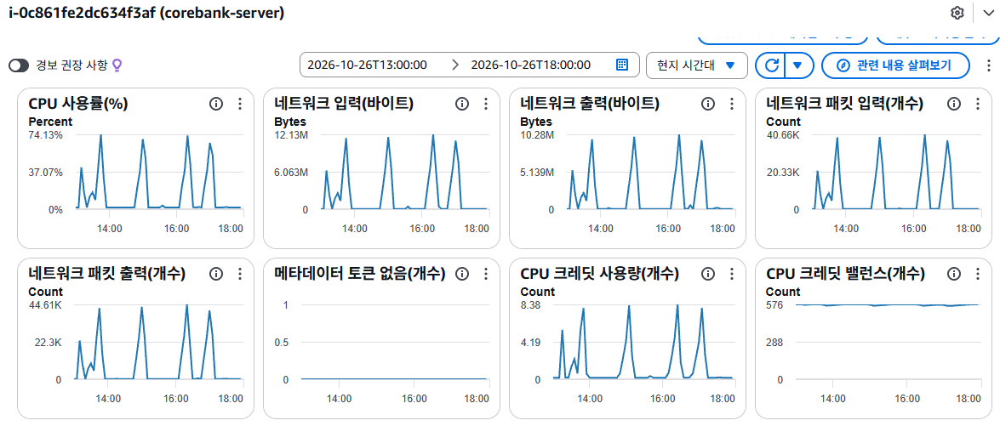
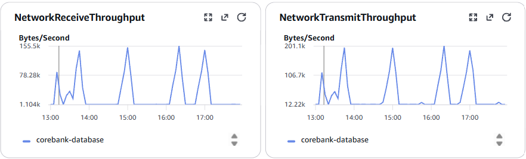
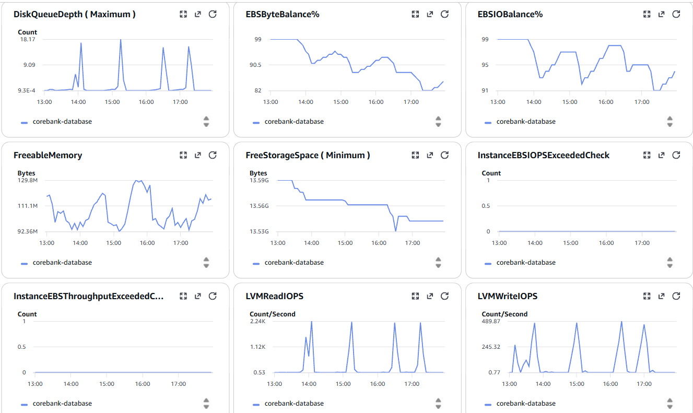
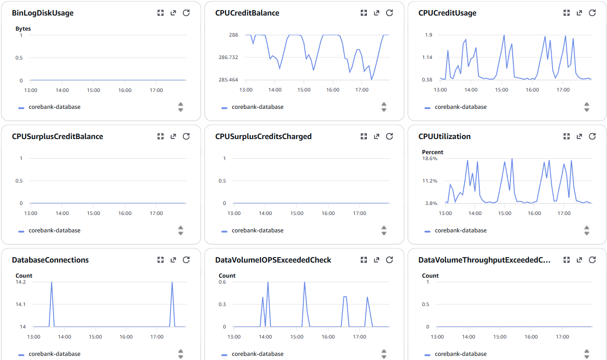

# PH-49c JDBC 세션 적용 후 운영 성능 재측정 결과 (C)

측정 계획과 구현 검증은 [ph49c_jdbc_session.md](ph49c_jdbc_session.md#운영-성능-재측정-계획), 실행 절차의 재현 명령은 [PH-49c C 측정 실행 가이드](ph49c_jdbc_session_runbook.md)를 따른다. 이 문서는 2026-10-26 KST 기준 C 측정의 회차별 결과와 4회 종합 판정을 기록한다.

EC2·RDS CloudWatch 그래프 이미지는 아래에 첨부했다. 서버 오류 로그 전문과 MySQL·k6 콘솔 출력 전문은 이 PR에 포함하지 않았다. 봉우리의 분 단위 시각은 측정 당시 CloudWatch 그래프에 마우스를 올려 표시된 툴팁으로 확인한 관찰 기록이다. 아래 캡처에는 툴팁이 포함되지 않아, 이미지 자체만으로 정확한 분 단위 시각을 재확인할 수는 없다. 서버 오류는 본문에 시각·예외·풀 상태를 요약하고 10/s 전체 구간의 재조회·집계 명령을 뒤에 남겼다. SQL과 k6의 판정값은 각 결과표에 옮겼다.

RDS 이미지에는 네트워크 처리량, 디스크 대기열·EBS 잔고·메모리·스토리지, CPU·크레딧·연결 수 등이 표시된다. `DiskQueueDepth`는 스토리지 I/O 대기열 지표로, **DB 행 잠금 대기 건수**를 보여주는 지표는 아니다. 이 캡처들에는 행 잠금 대기나 `SPRING_SESSION` 테이블의 조회·갱신 횟수는 없다. 아래 요청률별 RDS 표의 수치는 별도 CloudWatch API 조회 결과다.

## 측정 조건

측정 당시 보존된 `times.log`의 시각 오프셋은 `+0900`이다. 저장된 20개 수준별 k6 로그에는 시나리오 `duration: 3m0s`, `gracefulStop: 30s`가 표시된다. 저장소 이력상 10/26 이전 `perf/k6/load.js`의 마지막 변경 커밋은 `f608e8effb499504d74bb5a9bd236a70df426b25`(10/14)이며, 10/29 Git Bash에서 다시 확인한 `git log -1 --format=%H -- perf/k6/load.js`도 같은 값이다. k6는 측정일인 10/26 처음 설치했고 이후 업데이트하지 않았다는 실행자 확인을 근거로, **측정에 사용한 버전은 `k6.exe v2.2.0 (commit/00a9a1b7f5, go1.26.5, windows/amd64)`**로 기록한다. 이 버전 문자열은 10/29 `k6 version`으로 사후 확인했으며 측정 당일 출력은 보존되지 않았다. 당시 로컬 checkout의 HEAD·변경 상태도 보존되지 않아 실행한 소스의 정확한 revision은 확정할 수 없다.

`times.log`의 수준별 START·END는 k6 프로세스 시각으로, 세션을 만드는 `setup()`과 종료 대기도 포함한다. k6의 3분 고정 도착률 구간과 SQL의 회차별 넓은 검사 구간은 같은 시간 범위가 아니다. 따라서 성공 건수를 180초로 나눈 TPS는 **명목상 3분 부하 기준 처리량**이며, SQL `success_count`와 수치가 반드시 같아야 하는 것으로 해석하지 않는다. 요청별 정확한 경계를 맞춘 대조에는 시나리오 시작·종료 시각과 응답 완료 시각의 별도 계측이 필요하다.

기존 ALB → 단일 EC2 → 기존 RDS에서 **PH-49c의 JDBC 로그인 세션**, Hikari 메인 풀 10개로 측정했다. B′의 `provider=jdbc`는 일회성 저장소 모드의 명칭이며 로그인 세션의 JDBC 저장과 구분한다. 기록된 운영 이미지 SHA는 `176fe574b6b5d2a1008ce9ce9359753b4d658cdb`다. 10/27 운영 EC2에서 실행 중인 `corebank-server` 컨테이너를 `docker inspect`로 확인한 이미지 태그도 **`corebank/corebank-server:176fe574b6b5d2a1008ce9ce9359753b4d658cdb`**였고, 로컬 Docker 이미지 ID는 `sha256:78275514aba911e51bbd171db6e56a50f71c467c75640869b3bc422df134e0bb`였다. 같은 컨테이너의 `started_at`은 **2026-10-24 02:32:15.706352567 UTC(10/24 11:32:15 KST)**로 1회차 시작(10/26 13:26:24 KST)보다 이르다. 따라서 현재 컨테이너는 네 회차 내내 재시작되지 않았고, 위 이미지로 실행 중이었다. 부하 스크립트는 `perf/k6/load.js`이며, 목표 도착률 1·2·3·5·10/s를 각 3분 적용했다. 측정 당시 PH-30 성능 개선은 아직 운영에 적용되지 않았다. 아래 시각은 KST이고, 검사 구간은 시작 시각 이상·종료 시각 미만이다. **10/26은 README의 기존 일정과 달리 인프라 작업이 없는 날이었고, 리허설은 10/27·컷오버는 10/28로 변경됐다. P4가 디스코드 공지로 10/26 측정을 허용했다.**

10/27 사후 경로 확인에서 기존 ALB `corebank-alb`의 대상 그룹 `corebank-tg`에는 앱 EC2 `i-0c861fe2dc634f3af` **1대만 `healthy`**로 등록돼 있었다. 해당 EC2의 컨테이너 `DB_HOST`는 RDS `corebank-database`의 Endpoint(`corebank-database.cn6i0sa822p5.ap-northeast-2.rds.amazonaws.com`)와 일치했다. 실행 프로필은 `prod,qa-seed`였고, 컨테이너 환경변수에 `SPRING_DATASOURCE_HIKARI_MAXIMUM_POOL_SIZE`는 없었다. 컨테이너 기동 명령은 `java -jar app.jar`이며 추가 인자도 없었다. **실행 이미지의 `application-prod.yml`에는 Hikari 풀 10이 설정돼 있고, 확인한 환경변수·기동 인자에는 이 값을 덮어쓰는 항목이 없다.** 네 회차 10/s 오류 로그에서도 메인 풀 `HikariPool-1`은 대기 요청이 40~88건까지 쌓인 동안 반복해서 `total=10, active=10, idle=0`을 기록했다. 실행 이미지의 `maximum-pool-size: 10`, 확인된 환경변수·기동 인자에 덮어쓰기 항목이 없는 점, 운영 중 반복된 `total=10` 로그를 함께 근거로 **C 측정 당시 메인 풀의 최대 크기는 10개로 판단한다.** 로그로는 그 10개가 모두 사용 중인 상태도 직접 확인됐다.

[PH-30 측정 기준](harness_results.md#2-측정-결과--2026-10-05-수준별)의 견딤은 **성공률 100%·HTTP 오류율 1% 미만·이체 p95 1초 미만**, 포화는 **HTTP 오류율 10% 초과 또는 유실 발생**이다. 목표 도착률은 이체 완료 처리량이 아니므로 두 값을 혼동하지 않는다. B′는 같은 운영 ALB·단일 `t3.small` EC2·RDS `db.t4g.micro`·Hikari 풀 10개에서 `SESSION_POOL=MAX_VUS=200`으로 측정했다([PH-101-② 측정 조건](ph101_redis_removal_results.md#1-측정-조건)). C에서도 같은 인프라·풀·목표 도착률을 사용했다. 저장소의 `git diff 1709c355 176fe574 -- perf/k6 perf/sql/verify_integrity.sql` 결과가 비어 있어, B′와 C의 배포 이미지 사이에 부하 스크립트와 정합성 SQL의 추적된 내용 변경은 없었다. 다만 C 실행 당시 부하 생성기 로컬 작업 트리 상태는 별도 기록으로 검증하지 못했다. 데이터 규모는 B′ 문서에 릴리스 1 직후 `gl_voucher` 약 323만 행, C 직전 사후 추정치 3,262,359행으로 같은 규모였지만, B′의 전체 테이블 시작 행 수가 없어 데이터 조건 전부가 같았다고 단정하지 않는다. 부하 생성 기기 조건도 B′ 기록으로 확인되지 않았다.

### 데이터 규모 추정 (사후 조회)

운영 DB를 과거 시점으로 복원하지 않고, **현재 남아 있는 행**의 시각 컬럼으로 1회차 시작 직전(13:26:24 미만)과 4회차 종료 직후(17:07:00 미만)의 건수를 역산했다. 시각은 2026-10-26 KST 기준이며, `ledger_entry`는 `created_at`이 없어 `occurred_at`, 나머지는 `created_at`을 사용했다.

| 테이블 | 1회차 직전 추정 | 4회차 종료 직후 추정 | 차이 |
|---|---:|---:|---:|
| customer | 60,003 | 60,003 | 0 |
| account | 180,011 | 180,011 | 0 |
| transfer | 3,187,426 | 3,197,929 | +10,503 |
| ledger_entry | 6,601,289 | 6,622,023 | +20,734 |
| gl_voucher | 3,262,359 | 3,272,726 | +10,367 |
| gl_journal_entry | 6,524,718 | 6,545,452 | +20,734 |

이는 **측정 당시의 정확한 스냅샷이 아닌, 현재 잔존 행 기준 추정치**다. P6에 따르면 이 측정 기간에 다른 담당자의 성능 테스트는 없었다. 4회차 종료 후 정상적으로 생성 시각이 기록된 행은 종료 시각 조건에서 제외된다. 다만 이후 삭제된 행은 빠지고, 이후 과거 시각으로 적재된 행은 포함될 수 있다. 특히 `ledger_entry.occurred_at`은 실제 행 생성 시각과 다를 수 있다. 두 추정치의 차이는 C 측정 기간의 증가량이며, 그 기간에 다른 경로로 생성된 거래가 있었다면 함께 포함된다.

### 모니터링 지표의 집계 단위

두 자원의 표본 간격이 달라 CloudWatch 조회 결과를 다음처럼 배치했다. 이는 수집한 지표의 집계 방식이며, 서버 오류 로그의 건수 집계와는 별개다.

| 자원 | 실제 반환 표본 | 문서의 집계 단위 | 선택 이유 |
|---|---|---|---|
| RDS | 각 3분 요청률 구간에 60초 표본 3~4개 | **회차 × 요청률** | 같은 5/s·10/s 수준끼리 B′ 기록값과 대조할 수 있고, 구간 안의 범위·평균·최대값을 계산할 표본이 있다. |
| EC2 | CPU·네트워크 표본이 약 5분 간격; 각 3분 요청률 구간에는 0~1개 | **회차 전체** | 요청률별 평균을 낼 표본이 부족하고 5분 표본에 인접 구간의 부하가 섞일 수 있다. 회차 중 자원 변화와 최고값 시각을 확인하는 용도로 묶었다. |

EC2 대상은 `corebank-server` 인스턴스(`i-0c861fe2dc634f3af`, `t3.small`)다. CPU·네트워크는 `--period 60`, CPU 크레딧은 `--period 300`으로 조회했다. `--period 60`으로 요청해도 실제 CPU·네트워크 표본은 약 5분 간격이었다. 반환 표본 범위와 구간 평균은 각 표본의 `Average`, 최대값은 각 표본의 `Maximum` 기준이므로 최대값이 표본 범위의 상한보다 클 수 있다. 네트워크 바이트·패킷은 표본 기간의 양이며 초당 값이 아니다. 모든 최대값 시각은 KST다.

EC2 표의 **구간 평균**은 회차 전체 조회에서 반환된 표본 `Average`들의 산술평균이고, **최대값**은 표본 `Maximum` 중 가장 큰 값이다. 둘 다 1·2·3·5·10/s와 구간 사이 공백이 함께 들어간 회차 전체의 관측값이므로 특정 요청률의 CPU 사용률이나 B′의 5/s·10/s 값과 직접 비교하지 않는다. EC2를 `--period 60`으로 조회해도 실제 반환 간격은 약 5분이었다. RDS도 요청률 경계에 걸친 60초 표본에는 이웃 구간의 시간이 일부 포함될 수 있으며, B′ RDS 값의 집계 조건은 별도로 확인되지 않았다.

## 1회차 (2026-10-26)

성능 테스트 전체 시간: **13:26:24 시작 ~ 13:50:49 종료 (KST)**.

| 수준 | 측정 구간 (KST) | 이체 API 성공 / 호출 | 판독 |
|---|---|---:|---|
| 1/s | 13:26:24~13:29:48 | 181 / 181 | 실패 0 |
| 2/s | 13:32:09~13:35:32 | 360 / 360 | 실패 0 |
| 3/s | 13:40:01~13:43:25 | 541 / 541 | 실패 0 |
| 5/s | 13:43:29~13:46:52 | 901 / 901 | 실패 0 |
| 10/s | 13:47:21~13:50:49 | 545 / 806 | 포화 관측 |

각 수준의 k6 프로세스는 종료 코드 0으로 끝났다. 이는 개별 요청이 모두 성공했다는 뜻은 아니다. 10/s에서 `transfer_success`는 67.6%, `http_req_failed`는 1,205건, `dropped_iterations`는 50건이었다. 콘솔 로그에는 계좌 비밀번호 확인·OTP 발급·OTP 확인 단계의 HTTP 500도 각각 419·294·216건 집계됐다. 이체 기록이 생성되기 전 단계의 실패도 있으므로 HTTP 실패 건수와 DB의 이체 `ERROR` 건수는 일치하지 않는다.

10/s 구간의 서버 로그에는 13:47:51부터 `HikariPool-1 - Connection is not available, request timed out after 3000ms`가 반복됐다. 당시 풀은 `total=10, active=10, idle=0`이고 대기 요청은 41건에서 60건 이상으로 증가했다. 근본 예외는 `SQLTransientConnectionException`이며, JDBC 세션 조회·저장, 계좌 비밀번호 확인, OTP 발급, 이체 사전검사 등에서 커넥션 획득에 실패했다. 이는 10/s의 HTTP 500 급증과 직접 연결된다. 커넥션 점유가 길어진 상위 원인은 이 로그만으로 확정하지 않는다.

EC2 그래프에서 13:50 전후의 자원 상승이 관측됐다. CloudWatch API 조회에서 CPU·네트워크 입출력의 최대 표본 시각은 **13:45**, CPU 크레딧 사용량은 **13:46**이었다. 기존 운영 분석은 WAS CPU 포화를 풀 대기 초과의 상위 원인으로 확인했다([harness_results.md §3](harness_results.md#3-측정-결과--2026-10-06-세션-풀-보정-후)). 이번 집계 지표만으로 커넥션 점유의 인과관계나 DB 부하·락 대기를 배제할 수는 없다.

### 정합성

`perf/sql/verify_integrity.sql`을 13:26:24~13:50:49 구간에 실행했다. MySQL 세션 시각대는 `Asia/Seoul`이었다.

| 검사 | 결과 |
|---|---:|
| `broken_ledger_pairs` | 0 |
| `balance_mismatches` | 0 |
| `limit_usage_mismatches` | 0 |

| `total_transfers` | `success_count` | `error_count` | `success_amount` (원) |
|---:|---:|---:|---:|
| 2,568 | 2,541 | 27 | 50,582,648 |

`ERROR` 27건의 `error_code`는 모두 `CMN9999`다. 각각이 같은 커넥션 예외 때문인지는 거래별 로그 대조 전까지 확정하지 않는다. `limit_usage_mismatches` 쿼리는 검사 구간만이 아니라 10/26 하루 전체의 성공 이체 누계를 대조한다.

## 2회차 (2026-10-26)

성능 테스트 전체 시간: **14:49:43 시작 ~ 15:06:49 종료 (KST)**.

| 수준 | 측정 구간 (KST) | 이체 API 성공 / 호출 | 판독 |
|---|---|---:|---|
| 1/s | 14:49:43~14:53:08 | 180 / 180 | 실패 0 |
| 2/s | 14:53:08~14:56:32 | 361 / 361 | 실패 0 |
| 3/s | 14:56:32~14:59:54 | 541 / 541 | 실패 0 |
| 5/s | 14:59:54~15:03:22 | 901 / 901 | 실패 0 |
| 10/s | 15:03:22~15:06:49 | 580 / 877 | 포화 관측 |

각 수준의 k6 프로세스는 종료 코드 0으로 끝났다. 1~5/s에서는 `transfer_success` 실패와 `http_req_failed`가 없었다. 10/s에서는 `transfer_success` 성공률 66.1%, 이체 API 실패 297건, `http_req_failed` 1,169건, `dropped_iterations` 52건이었다. 10/s 콘솔 로그에는 HTTP/2 `INTERNAL_ERROR`를 수신한 요청 경고도 있으나, 이것만으로 오류 발생 계층을 확정할 수 없다. 5/s 구간은 15:00 정각 스케줄 작업과 겹쳤지만 이체 호출 901건은 모두 성공했다. 이 겹침은 지연 지표를 다른 회차와 비교할 때 고려한다.

2회차 10/s 서버 로그에서도 `HikariPool-1 - Connection is not available, request timed out after 3000ms`가 반복됐다. 15:06:42~15:06:46 KST 무렵 메인 풀은 `total=10, active=10, idle=0`이고 대기 요청은 80건대(측정 당시 수집한 로그 발췌에서 최대 88건)였다. 근본 예외 `SQLTransientConnectionException`으로 JDBC 세션 조회·저장, 계좌 비밀번호 확인, OTP 토큰 조회, 이체 사전검사·멱등성 처리 등에서 커넥션 획득에 실패했다. 오류 응답·세션 저장·오류 기록 시도에도 같은 풀이 필요해 연쇄 예외가 남았다. 따라서 10/s의 HTTP 실패 급증은 1회차와 같이 커넥션 획득 타임아웃과 직접 연결된다. 다만 이 로그만으로 풀 점유가 길어진 상위 원인이나 DB `ERROR` 37건 각각의 원인을 확정할 수는 없다.

측정 당시 확인한 EC2 CloudWatch 그래프에서는 2회차 자원 사용량이 14:57~14:59 KST에 급격히 상승했다. 이는 **3/s 구간(14:56:32~14:59:54)**이며, 10/s 시작(15:03:22)보다 앞선다. 앞서 이 상승을 10/s에 대응시킨 해석은 정정한다. API 조회에서 CPU·네트워크 입력의 `Maximum` 최대 표본 시각은 **15:05**다. 3/s의 이체 호출 541건은 모두 성공했으므로, 자원 급등과 요청 실패·풀 고갈이 시작된 시점을 동일하게 볼 수 없다. 이 집계 지표만으로 급등 원인을 확정할 수는 없다.

### 정합성

MySQL 세션 시각대 `Asia/Seoul`에서 `perf/sql/verify_integrity.sql`의 검사 구간을 14:49:43 이상·15:06:49 미만으로 설정해 실행했다.

| 검사 | 결과 |
|---|---:|
| `broken_ledger_pairs` | 0 |
| `balance_mismatches` | 0 |
| `limit_usage_mismatches` | 0 |

| `total_transfers` | `success_count` | `error_count` | `success_amount` (원) |
|---:|---:|---:|---:|
| 2,612 | 2,575 | 37 | 51,260,455 |

`ERROR` 37건의 오류코드와 원인은 아직 개별 조회하지 않았다. `limit_usage_mismatches`는 1회차와 마찬가지로 10/26 하루 전체의 성공 이체 누계를 대조한다.

## 3회차 (2026-10-26)

성능 테스트 전체 시간: **16:09:22 시작 ~ 16:26:29 종료 (KST)**.

| 수준 | 측정 구간 (KST) | 이체 API 성공 / 호출 | 판독 |
|---|---|---:|---|
| 1/s | 16:09:22~16:12:48 | 181 / 181 | 실패 0 |
| 2/s | 16:12:48~16:16:13 | 361 / 361 | 실패 0 |
| 3/s | 16:16:13~16:19:36 | 541 / 541 | 실패 0 |
| 5/s | 16:19:36~16:23:01 | 901 / 901 | 실패 0 |
| 10/s | 16:23:01~16:26:29 | 637 / 885 | 포화 관측 |

각 수준의 k6 프로세스는 종료 코드 0으로 끝났다. 1~5/s에서는 `transfer_success` 실패와 `http_req_failed`가 없었다. 10/s에서는 이체 API 885건 중 637건 성공·248건 실패(`transfer_success` 72.0%), `http_req_failed` 1,111건, `dropped_iterations` 52건이었다. 10/s 콘솔 로그에는 HTTP/2 `INTERNAL_ERROR`를 수신한 요청 경고도 있다. 2/s 구간은 16:15 인증 토큰 정리 스케줄과 시간상 겹치지만, 실제 실행 여부와 부하 영향은 서버 로그를 확인해야 한다.

3회차 EC2 자원 사용량 그래프의 첫 번째 봉우리는 약 16:20 KST로 관측됐다. 이는 **5/s 구간(16:19:36~16:23:01)**에 해당하며, 10/s 시작(16:23:01)보다 앞선다. CloudWatch API 조회에서 CPU·네트워크 입력의 `Maximum` 최대 표본 시각은 **16:25**, 네트워크 출력은 16:20이다. 5/s의 이체 호출 901건은 모두 성공했다.

측정 당시 수집한 3회차 서버 오류 로그 발췌에서는 10/s 구간의 16:23:33 KST부터 `HikariPool-1 - Connection is not available, request timed out after 3000ms`가 반복됐다. 메인 풀은 `total=10, active=10, idle=0`이었고, 발췌에서 확인된 대기 요청은 42~64건이었다. JDBC 세션 처리와 계좌 비밀번호 확인, OTP 발급·검증, 이체 실행 경로에서 커넥션 획득 실패가 나타났다. 발췌에는 앞부분에 2회차 로그 일부가 섞여 있고, 3회차도 일부 오류만 포함돼 있다. 따라서 10/s의 HTTP 실패가 풀 고갈과 연결되는 것은 확인되지만, DB에 기록된 `ERROR` 37건 각각의 원인까지 확인된 것은 아니다.

### 정합성

MySQL 세션 시각대 `Asia/Seoul`에서 `perf/sql/verify_integrity.sql`의 검사 구간을 16:09:22 이상·16:26:29 미만으로 설정해 실행했다.

| 검사 | 결과 |
|---|---:|
| `broken_ledger_pairs` | 0 |
| `balance_mismatches` | 0 |
| `limit_usage_mismatches` | 0 |

| `total_transfers` | `success_count` | `error_count` | `success_amount` (원) |
|---:|---:|---:|---:|
| 2,656 | 2,619 | 37 | 52,136,772 |

`ERROR` 37건의 오류코드와 원인은 아직 개별 조회하지 않았다. `limit_usage_mismatches`는 10/26 하루 전체의 성공 이체 누계를 대조한다.

## 4회차 (2026-10-26)

성능 테스트 전체 시간: **16:49:26 시작 ~ 17:06:59 종료 (KST)**.

| 수준 | 측정 구간 (KST) | 이체 API 성공 / 호출 | 판독 |
|---|---|---:|---|
| 1/s | 16:49:26~16:52:56 | 181 / 181 | 실패 0 |
| 2/s | 16:52:57~16:56:25 | 361 / 361 | 실패 0 |
| 3/s | 16:56:25~16:59:52 | 540 / 540 | 실패 0 |
| 5/s | 16:59:52~17:03:25 | 901 / 901 | 실패 0 |
| 10/s | 17:03:25~17:06:59 | 596 / 858 | 포화 관측 |

각 수준의 k6 프로세스는 종료 코드 0으로 끝났다. 1~5/s에서는 `transfer_success` 실패와 `http_req_failed`가 없었다. 10/s에서는 이체 API 858건 중 596건 성공·262건 실패(`transfer_success` 69.5%), `http_req_failed` 1,152건, `dropped_iterations` 53건이었다. 5/s 구간은 17:00 정각 스케줄 작업과 시간상 겹쳤지만 실제 실행 여부와 부하 영향은 서버 로그를 확인해야 한다.

측정 당시 확인한 3·4회차 **EC2 CloudWatch** 그래프에서 CPU 사용률, 네트워크 입·출력 바이트와 패킷 수, CPU 크레딧 사용량이 함께 두 차례 상승한다. 첫 번째 봉우리는 3회차 약 16:20 KST에, 두 번째 봉우리는 4회차 **17:00~17:04 KST** 사이에 표시된다. 두 번째 봉우리는 4회차 5/s 구간(16:59:52~17:03:25)과 10/s 구간(17:03:25~17:06:59)에 걸친다. CloudWatch API의 CPU·네트워크 입력 `Maximum` 최대 표본 시각은 **17:05**, 네트워크 출력은 17:00이다. CPU 크레딧 잔고는 그래프상 큰 하락 없이 유지되고 메타데이터 토큰 없음 지표는 0이다. 이 화면은 EC2 지표이므로 RDS 연결 수·CPU·잠금 대기를 보여주지 않으며, 자원 급등 원인을 확정할 수 없다.

측정 당시 수집한 4회차 오류 로그 발췌에서는 10/s 구간의 17:04:00~17:04:13 KST에 `HikariPool-1 - Connection is not available, request timed out after 3000ms`가 반복됐다. 메인 풀은 `total=10, active=10, idle=0`이었고, 발췌에서 확인된 대기 요청은 42~65건이었다. JDBC 세션 조회·저장, OTP 발급·검증 및 이체 실행 경로에서 커넥션 획득 실패와 연쇄 예외가 나타났다. 수집한 발췌 앞부분에는 3회차 로그가 섞여 있으며, 4회차도 명령의 `head -80`으로 잘린 일부 오류만 포함한다. 따라서 10/s의 HTTP 실패는 풀 고갈과 연결되지만, DB `ERROR` 35건 각각의 원인이나 전체 구간의 오류 건수는 이 파일만으로 확정할 수 없다.

### 정합성

`perf/sql/verify_integrity.sql`의 검사 구간을 16:49:26 이상·17:06:59 미만으로 설정해 운영 MySQL에서 실행했다. 아래 표는 해당 구간의 SQL 실행 결과를 옮긴 것이다.

| 검사 | 결과 |
|---|---:|
| `broken_ledger_pairs` | 0 |
| `balance_mismatches` | 0 |
| `limit_usage_mismatches` | 0 |

| `total_transfers` | `success_count` | `error_count` | `success_amount` (원) |
|---:|---:|---:|---:|
| 2,612 | 2,577 | 35 | 51,300,288 |

`ERROR` 35건의 오류코드와 원인은 아직 개별 조회하지 않았다. `limit_usage_mismatches`는 앞선 회차와 마찬가지로 10/26 하루 전체의 성공 이체 누계를 대조한다.

## 사후 추가 검사 — 동일 계좌 100건 (`integrity.js`, 2026-10-27)

1~4회차에는 `perf/k6/integrity.js`를 실행하지 않아, 10/27 17:48:01~17:48:49 KST에 **별도 핫스팟 검사**로 실행했다. 실행 직전 확인한 기존 ALB 대상 그룹에는 앱 EC2 `i-0c861fe2dc634f3af` 1대만 `healthy`로 등록돼 있었고, 해당 EC2의 컨테이너 이미지 태그와 시작 시각은 위 측정 조건에 기록한 값과 같았다. 컨테이너 `DB_HOST`도 기존 RDS `corebank-database`의 Endpoint와 일치했다. 따라서 **ALB·EC2·RDS 경로와 실행 컨테이너 이미지는 1~4회차의 확인된 조건과 일치**한다. 다만 실행일과 DB 데이터 상태, 동시 작업 여부까지 동일하다고 입증한 것은 아니므로 이 결과를 10/26 네 회차 중 한 회차의 검사로 소급하지 않는다.

`CONCURRENCY=100`, 건당 19,876원으로 같은 출금 계좌에 사용할 토큰 100쌍을 `setup()`에서 선발급한 뒤, 100 VU가 각각 이체 1건을 실행했다. 아래 표는 해당 k6 실행 결과를 옮긴 것이며 이 검사의 이체 지연을 분산 계좌 부하의 p95와 합산하지 않는다.

| 항목 | 결과 |
|---|---:|
| 이체 성공 | 100/100 (100%) |
| HTTP 실패 | 0/401 (0%) |
| 완료·중단 iteration | 100·0 |
| `transfer_duration` 평균·중앙값·p95·p99·최대 | 3.32초 · 3.66초 · 4.30초 · 4.41초 · 4.42초 |
| k6 종료 코드 | 0 |

추가 검사 구간(2026-10-27 17:48:01 이상·17:49:00 미만, KST)에 `verify_integrity.sql`을 실행했다. MySQL 세션 시각대는 `Asia/Seoul`이었고, SQL 실행 결과는 다음과 같다.

| 검사 | 결과 |
|---|---:|
| `broken_ledger_pairs` | 0 |
| `balance_mismatches` | 0 |
| `limit_usage_mismatches` | 0 |

| `total_transfers` | `success_count` | `error_count` | `success_amount` (원) |
|---:|---:|---:|---:|
| 100 | 100 | 0 | 1,987,600 |

**동일 계좌 100건 추가 검사의 이체 성공과 SQL 정합성 검사는 모두 통과했다.** `limit_usage_mismatches`는 SQL 구조상 이 구간이 속한 10/27 하루 전체의 한도 누계를 검사한다. 이 결과는 10/26 네 회차의 SQL 결과와 별도로 기록한다.

## 네 회차 모니터링 지표 비교

### EC2 회차 전체

| 회차 | 지표 | 반환 표본 범위 | 구간 평균 | 최대값 (KST) |
|---:|---|---:|---:|---:|
| 1 | CPUUtilization (조회 60초, %) | 9.1~74.1 | 34.2 | 99.7 (13:45) |
| 1 | NetworkIn (조회 60초, bytes) | 1,358,338.4~11,544,944 | 5,315,231 | 13,962,964 (13:45) |
| 1 | NetworkOut (조회 60초, bytes) | 1,143,116~9,598,137.8 | 4,459,798.8 | 11,792,740 (13:45) |
| 1 | NetworkPacketsIn (조회 60초, packets) | 4,582~38,980.4 | 17,892.9 | 47,132 (13:45) |
| 1 | NetworkPacketsOut (조회 60초, packets) | 5,028~42,398.2 | 19,459.8 | 52,149 (13:45) |
| 1 | CPUCreditUsage (300초, credits) | 0.6~8 | 3.5 | 8 (13:46) |
| 1 | CPUCreditBalance (300초, credits) | 566.4~576 | 573.2 | 576 (13:26) |
| 2 | CPUUtilization (조회 60초, %) | 21.2~69.4 | 44.8 | 99.3 (15:05) |
| 2 | NetworkIn (조회 60초, bytes) | 3,264,273.6~11,684,959.6 | 7,183,557.5 | 13,963,424 (15:05) |
| 2 | NetworkOut (조회 60초, bytes) | 2,916,216.4~9,949,965.4 | 6,058,108.2 | 11,660,969 (15:00) |
| 2 | NetworkPacketsIn (조회 60초, packets) | 10,872.8~39,275.2 | 24,206.4 | 47,713 (15:05) |
| 2 | NetworkPacketsOut (조회 60초, packets) | 12,018.4~43,126 | 26,341.4 | 51,639 (15:00) |
| 2 | CPUCreditUsage (300초, credits) | 0.6~8.3 | 3.9 | 8.3 (15:04) |
| 2 | CPUCreditBalance (300초, credits) | 566.9~575.9 | 572.9 | 575.9 (14:49) |
| 3 | CPUUtilization (조회 60초, %) | 22.5~73 | 44.5 | 99.3 (16:25) |
| 3 | NetworkIn (조회 60초, bytes) | 3,619,534.8~12,126,149.4 | 7,236,420.6 | 14,403,586 (16:25) |
| 3 | NetworkOut (조회 60초, bytes) | 3,214,177.4~10,277,908.8 | 6,103,791.9 | 11,646,857 (16:20) |
| 3 | NetworkPacketsIn (조회 60초, packets) | 12,072.6~40,658.2 | 24,329.5 | 49,085 (16:25) |
| 3 | NetworkPacketsOut (조회 60초, packets) | 13,334~44,609.6 | 26,500.7 | 51,593 (16:25) |
| 3 | CPUCreditUsage (300초, credits) | 0.7~8.4 | 4 | 8.4 (16:24) |
| 3 | CPUCreditBalance (300초, credits) | 566.5~576 | 572.7 | 576 (16:09) |
| 4 | CPUUtilization (조회 60초, %) | 21.2~65.7 | 44.6 | 99.2 (17:05) |
| 4 | NetworkIn (조회 60초, bytes) | 3,406,673.8~11,102,254 | 7,194,694.6 | 14,180,452 (17:05) |
| 4 | NetworkOut (조회 60초, bytes) | 3,036,145.8~9,469,712.6 | 6,061,942 | 11,808,477 (17:00) |
| 4 | NetworkPacketsIn (조회 60초, packets) | 11,487.2~37,394.8 | 24,328.7 | 48,471 (17:05) |
| 4 | NetworkPacketsOut (조회 60초, packets) | 12,656.2~40,996.8 | 26,380.3 | 52,033 (17:00) |
| 4 | CPUCreditUsage (300초, credits) | 0.7~8 | 3.8 | 8 (17:04) |
| 4 | CPUCreditBalance (300초, credits) | 564.8~573.3 | 570.5 | 573.3 (16:49) |

### RDS 요청률별

각 지표 칸은 60초 표본의 `Average` 범위 / 구간 평균 / `Maximum` 최대값 (KST) 순서다.

| 회차 | 수준 | 표본 수 | RDS CPU (%) | 연결 수 (개) | ReadIOPS (/s) | WriteIOPS (/s) |
|---:|---|---:|---|---|---|---|
| 1 | 1/s | 3 | 4.8~7.4 / 6.3 / 7.4 (13:28) | 14~14 / 14 / 14 | 1.0~2.3 / 1.7 / 2.3 (13:28) | 4.2~80.5 / 50.9 / 80.5 (13:28) |
| 1 | 2/s | 3 | 4.6~10.6 / 8.0 / 10.6 (13:34) | 14~14 / 14 / 14 | 1.1~2.0 / 1.7 / 2.0 (13:34) | 17.0~160.5 / 111.3 / 160.5 (13:34) |
| 1 | 3/s | 3 | 4.2~14.2 / 10.4 / 14.2 (13:42) | 14~14 / 14 / 14 | 2.9~3.6 / 3.3 / 3.6 (13:41) | 31.7~246.4 / 170.5 / 246.4 (13:42) |
| 1 | 5/s | 3 | 12.2~19.7 / 15.3 / 19.7 (13:45) | 14~14 / 14 / 14 | 3.5~7.8 / 5.1 / 7.8 (13:45) | 241.1~402.2 / 301.5 / 402.2 (13:45) |
| 1 | 10/s | 3 | 11.4~19.3 / 16.1 / 19.3 (13:49) | 14~14 / 14 / 14 | 5.8~7.0 / 6.3 / 7.0 (13:48) | 188.5~324.9 / 260.3 / 324.9 (13:49) |
| 2 | 1/s | 4 | 5.3~9.6 / 7.3 / 9.6 (14:51) | 14~14 / 14 / 14 | 0.7~43.7 / 15.2 / 43.7 (14:50) | 0.6~78.8 / 48.4 / 78.8 (14:51) |
| 2 | 2/s | 3 | 7.7~11.4 / 9.6 / 11.4 (14:55) | 14~14 / 14 / 14 | 4.0~5.3 / 4.5 / 5.3 (14:55) | 88.1~144.2 / 124.6 / 144.2 (14:54) |
| 2 | 3/s | 3 | 11.1~13.6 / 12.3 / 13.6 (14:58) | 14~14 / 14 / 14 | 4.5~4.7 / 4.6 / 4.7 (14:58) | 152.3~224.8 / 179.6 / 224.8 (14:58) |
| 2 | 5/s | 4 | 13.9~19.8 / 16.6 / 19.8 (15:02) | 14~14 / 14 / 14 | 4.1~8.5 / 5.5 / 8.5 (15:00) | 186.1~375.6 / 286.3 / 375.6 (15:02) |
| 2 | 10/s | 3 | 15.6~19.7 / 18.2 / 19.7 (15:03) | 14~14 / 14 / 14 | 5.9~7.7 / 6.7 / 7.7 (15:04) | 306.5~355.9 / 336.5 / 355.9 (15:03) |
| 3 | 1/s | 3 | 4.0~9.2 / 6.6 / 9.2 (16:11) | 14~14 / 14 / 14 | 1.8~48.2 / 19.4 / 48.2 (16:10) | 2.5~80.6 / 48.8 / 80.6 (16:11) |
| 3 | 2/s | 4 | 7.7~12.2 / 9.8 / 12.2 (16:15) | 14~14 / 14 / 14 | 3.8~5.8 / 4.6 / 5.8 (16:15) | 76.0~149.4 / 117.5 / 149.4 (16:15) |
| 3 | 3/s | 3 | 11.4~13.7 / 12.2 / 13.7 (16:18) | 14~14 / 14 / 14 | 2.9~3.9 / 3.4 / 3.9 (16:17) | 138.6~229.6 / 190.1 / 229.6 (16:18) |
| 3 | 5/s | 4 | 12.9~20.1 / 16.5 / 20.1 (16:21) | 14~14 / 14 / 14 | 3.5~7.7 / 5.0 / 7.7 (16:22) | 228.4~383.8 / 304.6 / 383.8 (16:21) |
| 3 | 10/s | 3 | 16.1~18.5 / 17.6 / 18.5 (16:25) | 14~14 / 14 / 14 | 4.8~7.1 / 5.9 / 7.1 (16:24) | 274.8~375.6 / 336.7 / 375.6 (16:24) |
| 4 | 1/s | 3 | 5.4~9.5 / 7.5 / 9.5 (16:51) | 14~14 / 14 / 14 | 1.1~52.7 / 21.4 / 52.7 (16:50) | 0.8~81.1 / 46.3 / 81.1 (16:51) |
| 4 | 2/s | 4 | 7.9~11.0 / 9.4 / 11.0 (16:55) | 14~14 / 14 / 14 | 4.0~7.7 / 5.3 / 7.7 (16:55) | 75.7~156.6 / 115.2 / 156.6 (16:55) |
| 4 | 3/s | 3 | 10.9~13.8 / 12.3 / 13.8 (16:58) | 14~14 / 14 / 14 | 4.3~6.8 / 5.4 / 6.8 (16:57) | 148.0~226.9 / 182.5 / 226.9 (16:58) |
| 4 | 5/s | 4 | 13.6~20.0 / 16.2 / 20.0 (17:02) | 14~14 / 14 / 14 | 3.8~8.1 / 5.6 / 8.1 (17:00) | 161.4~376.9 / 285.7 / 376.9 (17:02) |
| 4 | 10/s | 3 | 13.8~20.3 / 17.8 / 20.3 (17:05) | 14~14 / 14 / 14 | 4.2~9.2 / 6.8 / 9.2 (17:05) | 261.4~373.9 / 333.2 / 373.9 (17:03) |

## 4회 종합 판정과 B′ 비교

각 회차의 `c_runN_rateR_summary.json`에서 이체 성공률·HTTP 실패율·유실·이체 지연을 읽고, 중앙값은 네 회차 값의 가운데 두 개를 평균했다. 이체 외 세 단계의 지연은 `*_samples.json`에서 `http_req_duration`의 `step` 태그별 요청을 모아 회차별 p95·p99를 구한 뒤 네 값의 중앙값을 냈다. 로그인은 측정 구간 밖의 `setup()`에서 실행되므로 이 표에 포함하지 않는다. 아래 지연은 **단계별 HTTP 요청 시간**이며 전체 이체 흐름의 합계가 아니다.

| 목표 도착률 | 이체 성공률 중앙값 (범위) | HTTP 실패율 중앙값 | 유실 중앙값 (범위) | 이체 p95 중앙값 (범위), ms | 이체 p99 중앙값 (범위), ms | 판정 |
|---|---:|---:|---:|---:|---:|---|
| 1/s | 100% (100~100%) | 0% | 0 (0~0) | 147.8 (129.1~205.5) | 273.8 (195.0~308.3) | 견딤 |
| 2/s | 100% (100~100%) | 0% | 0 (0~0) | 126.1 (114.8~142.8) | 218.6 (143.1~262.7) | 견딤 |
| 3/s | 100% (100~100%) | 0% | 0 (0~0) | 126.0 (119.9~143.1) | 218.7 (179.8~273.5) | 견딤 |
| 5/s | 100% (100~100%) | 0% | 0 (0~0) | 153.2 (136.7~171.1) | 363.6 (251.5~504.4) | **견딤** |
| 10/s | 68.54% (66.13~71.98%) | 21.96% | 52 (50~53) | 9,469.9 (8,973.0~9,607.9) | 14,146.9 (12,800.6~14,323.9) | **포화** |

### 수준별 성공 이체 TPS와 도달률

여기서 **성공 이체 TPS는 3분 측정 구간의 성공 이체 건수 ÷ 180초**다. `c_runN_rateR_summary.json`의 `transfer_success` 성공·실패 건수로 이체 API 호출 수를, 성공 건수로 실제 성공 수를 구했다. 각 건수는 **4회 중앙값**이고 초당 수치는 해당 건수를 명목 측정 시간 180초로 나눈 근삿값이다. 도달률은 회차별 **이체 API 호출 수 ÷ 완료된 `iterations`**의 중앙값이다. 이체 전 단계에서 실패한 반복은 이체 API 호출 수에 포함되지 않는다. k6가 출력한 `iterations.rate`는 `setup()` 시간을 포함하므로 TPS 계산에 쓰지 않았다.

| 목표 도착률 | 이체 API 호출 (건 / 초당) | 성공 이체 (건 / TPS) | 이체 API 도달률 | 판정 |
|---|---:|---:|---:|---|
| 1/s | 181 / 약 1.01/s | 181 / 약 1.01 TPS | 100% | 견딤 |
| 2/s | 361 / 약 2.01/s | 361 / 약 2.01 TPS | 100% | 견딤 |
| 3/s | 541 / 약 3.01/s | 541 / 약 3.01 TPS | 100% | 견딤 |
| 5/s | 901 / 약 5.01/s | 901 / 약 5.01 TPS | 100% | **견딤** |
| 10/s | 867.5 / 약 4.82/s | 588 / 약 3.27 TPS | 49.6% | **포화** |

건수의 소수 `.5`는 개별 회차의 실제 건수가 아니라 짝수 회차 중앙값이다. 5/s에서는 네 회차 모두 이체 API 901건이 성공했지만, 10/s에서는 호출 중앙값이 867.5건으로 줄고 성공 이체 TPS도 약 3.27로 떨어졌다. 따라서 이번 C 측정에서 확인된 최고 안정 수준은 목표 도착률 **5/s**, 그때의 성공 이체 처리량은 **약 5.01 TPS**다. 목표 도착률 5/s와 10/s 사이의 한계점은 측정하지 않았다.

| 목표 도착률 | 계좌 비밀번호 p95 / p99 | OTP 발급 p95 / p99 | OTP 확인 p95 / p99 | 이체 p95 / p99 |
|---|---:|---:|---:|---:|
| 1/s | 201.4 / 366.9 | 210.7 / 498.7 | 153.1 / 251.3 | 147.8 / 273.8 |
| 2/s | 157.8 / 292.9 | 175.6 / 312.7 | 140.4 / 247.3 | 126.1 / 218.6 |
| 3/s | 161.6 / 294.0 | 174.2 / 248.0 | 142.8 / 221.8 | 126.0 / 218.7 |
| 5/s | 245.6 / 638.3 | 279.2 / 629.1 | 239.5 / 525.6 | 153.2 / 363.6 |
| 10/s | 6,195.4 / 9,184.7 | 6,264.3 / 9,769.7 | 6,095.3 / 8,753.4 | 9,469.9 / 14,146.9 |

단위는 ms이고 모두 4회 중앙값이다. 1~5/s는 네 회차 모두 이체 성공률 100%, HTTP 실패·유실 0이며 이체 p95가 매회 1초 미만이었다. 10/s는 네 회차 모두 이체 성공률 66.13~71.98%, HTTP 실패율 20.91~23.59%와 유실 50~53건을 보였다. [기존 판정 기준](harness_results.md#2-측정-결과--2026-10-05-수준별)에 따라 **측정한 수준 중 최고 견딤은 5/s, 10/s는 포화**다. 5/s와 10/s 사이의 포화 시작점은 측정하지 않았다. 네 회차 모두 정합성 불일치 세 항목은 0이었다.

[B′ JDBC 기준선](harness_results.md#8-2-수준별-중앙값--4회-중앙값)과 같은 이체 지표를 비교하면, 5/s p95 중앙값은 B′ 94.8ms → C 153.2ms(**+61.6%**)이고 C의 4회 범위(136.7~171.1ms)는 B′의 4회 범위(84.2~123.8ms)보다 높다. 10/s p95는 6,058.8 → 9,469.9ms(**+56.3%**), 이체 성공률은 75.35 → 68.54%(**−6.81%p**), 유실 중앙값은 23 → 52건이다. 이체 성공률의 분모는 두 측정 모두 이체 API까지 도달한 호출이며, 이체 전 계좌 비밀번호·OTP 단계에서 실패한 반복은 포함하지 않는다. 두 측정 모두 최고 견딤 5/s·10/s 포화라는 등급은 같다. B′와 C는 운영 이미지가 `1709c355`와 `176fe574b6b5d2a1008ce9ce9359753b4d658cdb`로 다르고 릴리스 2의 이체 경로 변경도 함께 포함하므로, 관측한 지연 증가를 PH-49c 단독 효과로 돌릴 수는 없다.

이체 전 세 단계도 [B′ JDBC 회차별 원자료](ph101_redis_removal_results.md#7-회차별-원자료)의 4회 p95 중앙값과 C의 4회 중앙값을 비교했다. 단위는 ms다.

| 단계 | B′ 5/s | C 5/s | B′ 10/s | C 10/s |
|---|---:|---:|---:|---:|
| 계좌 비밀번호 | 173 | 245.6 (+42%) | 3,227.9 | 6,195.4 (+92%) |
| OTP 발급 | 183.5 | 279.2 (+52%) | 3,315.5 | 6,264.3 (+89%) |
| OTP 확인 | 164 | 239.5 (+46%) | 3,125.2 | 6,095.3 (+95%) |

이체 경로에 추가된 PR #640의 영업일 조회를 거치지 않는 세 단계에서도 C의 지연이 같은 방향으로 증가했다. 특히 10/s의 p95는 B′ 약 3.1~3.3초에서 C 약 6.1~6.3초로 늘었다. 세션 JDBC 저장과 공용 Hikari 풀의 영향 가능성을 뒷받침하지만, p95만으로 커넥션 획득을 몇 번 기다렸는지 또는 PH-49c만의 효과인지는 판정할 수 없다. 릴리스 2의 다른 변경과 부하 생성기 조건 차이도 남아 있다.

B′의 나머지 견딤 구간 이체 p95 중앙값도 C보다 낮다: **1/s 144.9 → 147.8ms, 2/s 103.8 → 126.1ms, 3/s 85.3 → 126.0ms**다. 이 값은 B′와 C의 각 4회 중앙값 비교이며, 모든 회차가 동일한 폭으로 느려졌다는 뜻은 아니다. 과거 [PH-30 보정 후 측정](harness_results.md#3-측정-결과--2026-10-06-세션-풀-보정-후)의 10/s p95 약 9.85초는 Redis 모드 당시 수치다. [PH-101-② 판정](harness_results.md#8-3-개선-전-기준선--2--3--6-의-10s-값과-비교하지-않는다)은 Redis 제거 후 JDBC 모드의 10/s 지연이 달라졌음을 명시하므로, C의 10/s 비교 기준은 과거 PH-30 수치가 아닌 B′ 6,058.8ms다.

요청률별 RDS 표본에서는 C의 **5/s RDS CPU 구간 평균이 15.3~16.6%**(4회 중앙값 16.35%), **10/s는 16.1~18.2%**(중앙값 17.7%)다. [B′ 회차별 표](ph101_redis_removal_results.md#7-회차별-원자료)의 JDBC 4회는 5/s **12.7~15.0%**(기록값 중앙값 14.15%), 10/s **11.7~14.2%**(기록값 중앙값 13.65%)로 기록돼 있다. 연결 수는 C의 해당 표본이 모두 14개이고 B′는 5/s에 13~14개, 10/s에 13~14개다. **B′ 문서에는 RDS CPU 값이 평균인지 최대인지, 집계 주기와 조회 경계가 무엇인지 적혀 있지 않다.** 따라서 B′ 기록값과 C의 60초 표본 구간 평균을 같은 통계로 간주해 증감률을 계산하지 않는다. C도 각 수준에 3~4개의 표본만 반환됐다. 이 수치만으로 PH-49c 단독 효과나 DB 병목을 판정하지 않는다.

[B′ 정합성 기록](ph101_redis_removal_results.md#5-정합성--여덟-회차-전부-합격)은 JDBC 네 회차를 포함한 전체 여덟 회차에서 원장 짝·잔액·한도 불일치가 모두 0건이고, C도 네 회차의 같은 세 검사가 모두 0건이다. 이는 두 측정에서 검사한 범위의 불일치가 없었다는 비교이며, C의 `limit_usage_mismatches`는 각 회차만이 아닌 당일 누계를 대조한다. DB `ERROR` 건수는 정합성 불일치 건수가 아니다.

B′ 결과는 [PH-101-② 측정 문서](ph101_redis_removal_results.md)에 기록돼 있다. 해당 문서의 Git 작성자는 P1이며, 문서에는 P4가 RDS CloudWatch 원자료를 제공한 것으로 표기돼 있다. 실제 k6 실행자와 부하 생성 노트북의 사양·네트워크는 기록되지 않았다. 부하 생성 기기의 CPU·네트워크 상태, 회선 경로와 k6 버전 차이는 도착률 유지·유실·클라이언트에서 잰 응답시간에 영향을 줄 수 있다. 특히 B′와 C의 지연 차이를 해석할 때 이 조건이 통제됐다고 가정하지 않는다. 측정 당시 확인한 EC2 CloudWatch 그래프는 서버 자원 사용량을 보여주지만 부하 생성 기기의 상태는 보여주지 않는다.

네 회차의 10/s 서버 오류 로그에서 Hikari 메인 풀 `active=10, idle=0`과 3초 커넥션 획득 타임아웃이 반복됐다. 기존 3·4회차 오류 발췌는 `head -80`으로 잘렸지만, 이후 운영 컨테이너의 해당 10/s 전체 시간대 로그에서 Hikari 오류 메시지 줄 수를 별도로 집계했다. DB의 `ERROR` 건별 원인은 여전히 확정하지 못했다. **C의 네 회차 RDS CPU·연결 수·ReadIOPS·WriteIOPS 1분 표본은 요청률별로 확보했다.** 각 요청률 구간의 반환 표본은 3~4개이며 연결 수는 모두 14개였다. 이는 RDS 전체 연결 수이므로 애플리케이션의 Hikari 풀 대기 여부를 대신 보여주지 않는다. 잠금 대기·세션 테이블 조회 및 갱신 지표는 아직 확보되지 않았다. P4가 미확보된 잠금 대기·세션 테이블 세부 지표의 확인 가능 여부를 검토한다. 측정 당시 확인한 EC2 CloudWatch 화면은 RDS 상태를 보여주지 않는다. 미확보 지표를 받기 전에는 RDS 부하와 풀 고갈의 인과관계를 판정하지 않는다. C는 PH-30 성능 개선 전 현 운영 이미지의 기준선 후보이며, RDS 세부 지표 미확보와 동시 릴리스 변경을 비교의 한계로 둔다.

### 10/s Hikari 커넥션 획득 타임아웃 로그 수

| 회차 | 10/s 구간 (KST) | 전체 문구 줄 | Hikari `message` 줄 | `Caused by:` 포함 줄 |
|---|---|---:|---:|---:|
| 1회차 | 13:47:21~13:50:49 | 3,295 | 1,537 | 1,701 |
| 2회차 | 15:03:22~15:06:49 | 3,138 | 1,466 | 1,628 |
| 3회차 | 16:23:01~16:26:29 | 3,022 | 1,411 | 1,564 |
| 4회차 | 17:03:25~17:06:59 | 3,121 | 1,460 | 1,617 |
| **4회 중앙값** | | **3,129.5** | **1,463** | **1,622.5** |

기존 앱 EC2에서 `docker logs --since/--until`로 각 회차 10/s 구간을 조회했다. `전체 문구 줄`은 `/Connection is not available/`, `Hikari message 줄`은 `/"message":"HikariPool-1 - Connection is not available/`, `Caused by: 포함 줄`은 `/Caused by:.*Connection is not available/`로 `awk`가 센 값이다. 뒤의 두 열은 전체 문구 줄에 포함되므로 **열끼리 합산하지 않는다.** 세 값 모두 로그 줄 수이며 고유 실패 요청 수가 아니다. S4에서도 동일한 구간·검색식으로 다시 집계한다. [B′의 JDBC 10/s 중앙값 2,199.5건](ph101_redis_removal_results.md#2-결과)은 원래의 로그 집계 패턴·시간 경계가 문서에 없어, 동일 방식인지 P1에게 확인하기 전에는 증감률을 계산하지 않는다.

명령은 [실행 가이드 §6-1](ph49c_jdbc_session_runbook.md#6-1-10s-hikari-로그-집계)에 둔다.

같은 Hikari `message` 줄에서 비어 있지 않은 `correlationId`를 중복 제거한 결과는 다음과 같다.

| 회차 | 고유 `correlationId` 수 | ID 없는 Hikari 메시지 줄 수 |
|---|---:|---:|
| 1회차 | 1,147 | 315 |
| 2회차 | 1,093 | 309 |
| 3회차 | 1,049 | 298 |
| 4회차 | 1,092 | 301 |
| **4회 중앙값** | **1,092.5** | **305** |

고유 ID 수는 **Hikari 오류가 기록된 식별 가능한 요청 수**다. ID가 없는 메시지는 어떤 요청에 속하는지 알 수 없고, 한 요청에서 여러 메시지가 남았을 수도 있다. 따라서 이 값에 ID 없는 줄 수를 더하거나, 이를 전체 고유 실패 요청 수로 단정하지 않는다.

고유 ID 집계 명령도 [실행 가이드 §6-1](ph49c_jdbc_session_runbook.md#6-1-10s-hikari-로그-집계)에 둔다.

RDS·EC2 CloudWatch 조회 명령은 [실행 가이드 §6](ph49c_jdbc_session_runbook.md#6-실패-원인과-모니터링-확인)에 둔다.
